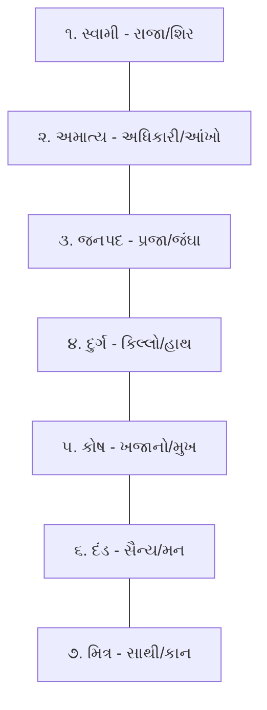
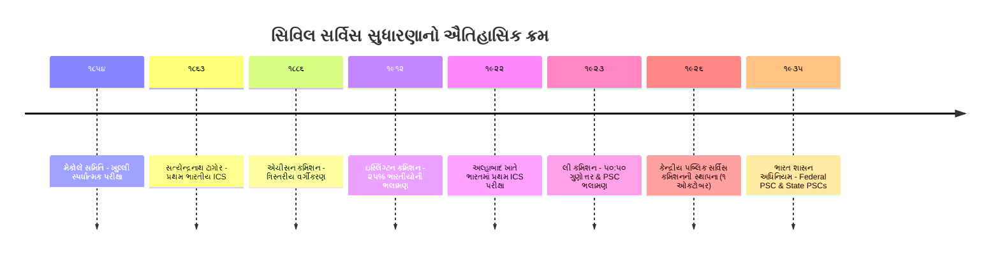

# જાહેર વહીવટ (Public Administration) - ભાગ ૩
## ભારતમાં જાહેર વહીવટ અને સનદી સેવાઓનો ઐતિહાસિક ઉદ્ભવ અને ક્રમિક વિકાસ
### પ્રાચીન-મધ્યકાલીન વહીવટ, મનસબદારી, અષ્ટપ્રધાન, બ્રિટિશ સિવિલ સર્વિસ (કોર્નવોલીસ, મેકોલે, લી કમિશન) & સરદાર પટેલ
### CCE Mains Group A (Paper-3 Section-3) & GPSC Class 1/2 Master Study Notes

---

## 📌 વિડિયો સંદર્ભ અને લેક્ચર માહિતી
* **વિડિયો સોર્સ:** [LearningPocket GPSC - જાહેર વહીવટ | Part-3 | Public Administration](https://www.youtube.com/live/9bpFs1K8qPc?si=6q9nHJuBNSZb5bc7)
* **યુટ્યુબ વિડિયો ID:** `9bpFs1K8qPc`
* **માર્ગદર્શક:** હેમંત શાહ સર (Hemant Shah Sir)
* **વિષય:** જાહેર વહીવટ અને શાસન (Public Administration and Governance)
* **CCE સિલેબસ મેપિંગ:** વિભાગ ૩, મુદ્દો ૧ (`sec3_top1` - ભારતીય વહીવટી તંત્રનો ઉદ્ભવ અને વિકાસ, સિવિલ સેવાઓની ઉત્ક્રાંતિ, બ્રિટિશ વારસો અને સ્વતંત્ર ભારતમાં સંસ્થાકીય માળખું)
* **ગુણભાર:** CCE Mains Group A માં જાહેર વહીવટ અને શાસનનો કુલ ભાર **૨૦ ગુણ** છે.

---

## 📚 પ્રકરણ અનુક્રમણિકા (Table of Contents)
1. [પ્રાચીન ભારતનો વહીવટી વારસો (Ancient Indian Administrative Heritage)](#1-પ્રાચીન-ભારતનો-વહીવટી-વારસો)
   - મૌર્ય કાળ અને કૌટિલ્યનું અર્થશાસ્ત્ર (સપ્તાંગ સિદ્ધાંત, અમાત્ય, તીર્થ)
   - ગુપ્ત કાળ અને સામંતશાહી વહીવટી વ્યવસ્થા (Feudal Administrative Structure)
2. [મધ્યકાલીન વહીવટી વ્યવસ્થાઓ (Medieval Administration)](#2-મધ્યકાલીન-વહીવટી-વ્યવસ્થાઓ)
   - દિલ્હી સલ્તનત: દીવાન-એ-વિઝારત, દીવાન-એ-અર્ઝ, દીવાન-એ-ઇન્શા, દીવાન-એ-રિસાલાત
   - દક્ષિણ ભારતીય વહીવટ: ચોલ સામ્રાજ્યનો સ્વાયત્ત ગ્રામ વહીવટ (ઉત્તરમેરુર શિલાલેખ) અને વિજયનગરની નાયંકર પ્રથા
   - શેરશાહ સૂરી (૧૫૪૦-૧૫૪૫): સરકાર અને પરગણા વહીવટ, જીટી રોડ, રૂપિયાનું ચલણ
3. [મુઘલ વહીવટી વ્યવસ્થા (Mughal Administration)](#3-મુઘલ-વહીવટી-વ્યવસ્થા)
   - કેન્દ્રીય વહીવટી માળખું (અબુલ ફઝલની 'આઈને અકબરી')
   - અકબરની મનસબદારી પ્રથા (Mansabdari System: જાત અને સવાર રેન્ક)
   - રાજા ટોડરમલ અને દહસાલા જમીન મહેસૂલ પદ્ધતિ (Zabti / Dahsala System)
4. [મરાઠા વહીવટ - છત્રપતિ શિવાજી મહારાજ (Maratha Administration)](#4-મરાઠા-વહીવટ---છત્રપતિ-શિવાજી-મહારાજ)
   - સ્વરાજ્ય અને અષ્ટપ્રધાન મંડળ (Ashtapradhan Council of 8 Ministers)
   - અષ્ટપ્રધાનની કાર્યાત્મક ભૂમિકા અને વિશેષતાઓ
   - મહેસૂલી પદ્ધતિ: કાઠી માપણી, ચોથ (૨૫%) અને સરદેશમુખી (૧૦%) કર
5. [બ્રિટિશ શાસનમાં ભારતીય વહીવટ અને સિવિલ સર્વિસનો ઉદ્ભવ](#5-બ્રિટિશ-શાસનમાં-ભારતીય-વહીવટ-અને-સિવિલ-સર્વિસનો-ઉદ્ભવ)
   - વોરન હેસ્ટિંગ્સ (૧૭૭૨): જિલ્લા કલેક્ટર (District Collector) પદનું સર્જન
   - લોર્ડ કોર્નવોલીસ (Lord Cornwallis) - "ભારતીય સિવિલ સર્વિસના પિતા"
   - કોર્નવોલીસ કોડ (૧૭૯૩): સત્તાનું પૃથક્કરણ અને પોલીસ સુધારા (દરોગા પ્રથા)
   - સિવિલ સેવકોની તાલીમ: ફોર્ટ વિલિયમ કોલેજ (૧૮૦૦) અને હેલીબરી કોલેજ (૧૮૦૬)
6. [સ્પર્ધાત્મક પરીક્ષાઓ અને ભારતીયકરણનો તબક્કો](#6-સ્પર્ધાત્મક-પરીક્ષાઓ-અને-ભારતીયકરણનો-તબક્કો)
   - ચાર્ટર એક્ટ ૧૮૫૩ અને મેકોલે સમિતિ (Macaulay Committee ૧૮૫૪)
   - ૧૮૫૫ થી લંડનમાં ખુલ્લી સ્પર્ધાત્મક પરીક્ષા (Open Competitive Examination)
   - સત્યેન્દ્રનાથ ટાગોર (૧૮૬૩): પ્રથમ ભારતીય ICS અધિકારી
   - સ્થાનિક સ્વરાજ્ય: ૧૬૮૮ મદ્રાસ કોર્પોરેશન અને લોર્ડ રિપન (૧૮૮૨)
7. [સિવિલ સર્વિસ સુધારણા પંચો (Commissions on Civil Services)](#7-સિવિલ-સર્વિસ-સુધારણા-પંચો)
   - એચીસન કમિશન (Aitchison Commission ૧૮૮૬) - ત્રિસ્તરીય વર્ગીકરણ
   - ઇસ્લિંગ્ટન કમિશન (Islington Commission ૧૯૧૨)
   - લી કમિશન (Lee Commission ૧૯૨૩-૨૪): ૫૦:૫૦ ગુણોત્તર અને PSC ની ભલામણ
   - પ્રથમ પબ્લિક સર્વિસ કમિશન (૧ ઓક્ટોબર ૧૯૨૬) - સર રોસ બાર્કર
   - ભારત શાસન અધિનિયમ ૧૯૩૫ (Federal PSC & Provincial PSCs)
8. [સ્વતંત્ર ભારતમાં અખિલ ભારતીય સેવાઓ અને સરદાર પટેલ](#8-સ્વતંત્ર-ભારતમાં-અખિલ-ભારતીય-સેવાઓ-અને-સરદાર-પટેલ)
   - સરદાર વલ્લભભાઈ પટેલ: "ભારતીય અખિલ ભારતીય સેવાઓના જનક"
   - મેટકાફ હાઉસ ભાષણ (૨૧ એપ્રિલ ૧૯૪૭) - "સ્ટીલ ફ્રેમ ઓફ ઈન્ડિયા" (Steel Frame of India)
   - રાષ્ટ્રીય સિવિલ સર્વિસીસ ડે (૨૧ એપ્રિલ)
   - બંધારણીય જોગવાઈઓ: ભાગ XIV (અનુચ્છેદ ૩૦૮ થી ૩૨૩), અનુચ્છેદ ૩૧૧ (સેવા રક્ષણ) & અનુચ્છેદ ૩૧૨ (નવી AIS નું સર્જન)
9. [CCE Mains પ્રશ્નોત્તરી (2 Marks & 5 Marks Model Answers)](#9-cce-mains-પ્રશ્નોત્તરી-model-answers)
10. [પરીક્ષાલક્ષી હાઈ-યીલ્ડ ૧૦ પ્રશ્નોત્તરી (MCQ Quiz with Explanations)](#10-પરીક્ષાલક્ષી-હાઈ-યીલ્ડ-૧૦-mcqs)

---

## 1. પ્રાચીન ભારતનો વહીવટી વારસો

ભારતમાં જાહેર વહીવટ કોઈ આધુનિક કે પશ્ચિમી શોધ નથી, પરંતુ તેનો ઐતિહાસિક પાયો હજારો વર્ષ જૂનો છે.

### (A) મૌર્ય કાળ (ઈ.પૂ. ૩૨૧ - ૧૮૫) અને કૌટિલ્યનું અર્થશાસ્ત્ર
* **કૌટિલ્ય (ચાણક્ય):** વિશ્વના સૌપ્રથમ વ્યવસ્થિત વહીવટી અને રાજનીતિ શાસ્ત્રના પ્રણેતા.
* **ગ્રંથ:** **'અર્થશાસ્ત્ર' (Arthashastra)** - ૧૫ અધિકરણો (પુસ્તકો), ૧૫૦ અધ્યાયો અને ૬૦૦૦ શ્લોકોમાં વિભાજિત.
* **સપ્તાંગ સિદ્ધાંત (Saptanga Theory of State):** રાજ્ય એક જીવંત શરીર સમાન છે જેના ૭ મુખ્ય અંગો છે:
  1. **સ્વામી (રાજા):** રાજ્યનું મગજ / શિર.
  2. **અમાત્ય (મંત્રીઓ / ઉચ્ચ અધિકારીઓ):** રાજ્યની આંખો.
  3. **જનપદ (પ્રદેશ અને પ્રજા):** રાજ્યની જંઘાઓ.
  4. **દુર્ગ (કિલ્લો):** રાજ્યના બાહુ/હાથ.
  5. **કોષ (ખજાનો):** રાજ્યનું મુખ.
  6. **દંડ / બલ (સૈન્ય):** રાજ્યનું મન.
  7. **મિત્ર (સહયોગી રાજ્યો):** રાજ્યના કાન.



* **વહીવટી માળખું:**
  - **તીર્થ (Tirthas):** કેન્દ્રના ૧૮ સર્વોચ્ચ વહીવટી વડાઓ (જેમ કે પ્રધાનમંત્રી, પુરોહિત, સેનાપતિ, સન્નિધાતા - તિજોરી વડા, સમાહર્તા - મુખ્ય કર ઉઘરાવનાર).
  - **અધ્યક્ષ (Adhyakshas):** ૨૭ જેટલા વિવિધ સરકારી વિભાગોના વડાઓ (ખાણ, વન, જકાત, વજન-માપ વગેરે).

### (B) ગુપ્ત કાળ (ઈ.સ. ૩૧૯ - ૫૪૦) - સામંતશાહી વહીવટી વ્યવસ્થા
* મૌર્ય કાળમાં વહીવટ અતિશય કેન્દ્રીકૃત (Centralized) હતો, જ્યારે ગુપ્ત કાળમાં વહીવટ **વિકેન્દ્રીકૃત (Decentralized)** બન્યો.
* **સામંતશાહી (Feudalism) નો ઉદ્ભવ:** રાજાઓ અધિકારીઓ અને સામંતોને રોકડ પગારના બદલે કરમુક્ત જમીન આપવા લાગ્યા. બદલામાં સામંતો રાજા માટે સૈન્ય રાખતા અને વહીવટ ચલાવતા.
* **કુમારામાત્ય (Kumaramatya):** ગુપ્ત સામ્રાજ્યનો સર્વોચ્ચ વહીવટી કેડર, જે આજના IAS ઓફિસર સમાન હતો.

---

## 2. મધ્યકાલીન વહીવટી વ્યવસ્થાઓ

### (A) દિલ્હી સલ્તનત (૧૨૦૬ - ૧૫૨૬)
દિલ્હી સલ્તનતમાં સુલતાન સર્વોચ્ચ શાસક, સેનાપતિ અને ન્યાયાધીશ હતો. કેન્દ્રીય વહીવટ ચાર મુખ્ય સ્તંભો (મંત્રાલયો) પર ચાલતો હતો:

| મંત્રાલય / વિભાગ | વડાનું પદ | મુખ્ય કાર્યક્ષેત્ર |
| :--- | :--- | :--- |
| **૧. દીવાન-એ-વિઝારત** | વઝીર (પ્રધાનમંત્રી) | નાણાં, અંદાજપત્ર અને મહેસૂલ વહીવટ |
| **૨. દીવાન-એ-અર્ઝ** | આરિઝ-એ-મમાલિક | સૈન્ય વહીવટ, સૈનિકોની ભરતી અને પગાર (બલબને સ્થાપ્યો) |
| **૩. દીવાન-એ-ઇન્શા** | દબીર-એ-ખાસ | શાહી પત્રવ્યવહાર અને સરકારી હુકમોનો મુસદ્દો |
| **૪. દીવાન-એ-રિસાલાત** | સદર-ઉસ-સુદૂર | વિદેશી સંબંધો અને ધાર્મિક/દાન બાબતો |

* **અન્ય મહત્વપૂર્ણ વિભાગો:**
  - **દીવાન-એ-રિયાસત:** અલાઉદ્દીન ખીલજી દ્વારા બજાર નિયંત્રણ અને કિંમતોના નિયમન માટે.
  - **દીવાન-એ-કોહી:** મોહમ્મદ બિન તુગલક દ્વારા ખેતી સુધારણા માટે સ્થાપાયેલ કૃષિ વિભાગ.
  - **દીવાન-એ-ખૈરાત & દીવાન-એ-બંદગાન:** ફિરોઝશાહ તુગલક દ્વારા ગરીબોને સહાય અને ગુલામોની સારસંભાળ માટે.
  - **કાઝી-ઉલ-કુઝ્ઝત:** સુલતાન પછીનો સર્વોચ્ચ ન્યાયિક અધિકારી.

### (B) દક્ષિણ ભારતનો વહીવટ: ચોલ સ્વાયત્ત ગ્રામ વહીવટ
* **ચોલ સામ્રાજ્ય (૯મી થી ૧૨મી સદી):** વિશ્વમાં સ્થાનિક સ્વરાજ્ય અને ગ્રામ્ય સ્વાયત્તતાનું શ્રેષ્ઠ ઉદાહરણ.
* **ઉત્તરમેરુર શિલાલેખ (Uttiramerur Inscription - ઈ.સ. ૯૧૯ અને ૯૨૧):** પ્રાંતક ચોલ પ્રથમના સમયનો આ શિલાલેખ ગ્રામ વહીવટની અનોખી ચૂંટણી પદ્ધતિ દર્શાવે છે.
* **કુદાવલાઈ પ્રથા (Kudavolai System):**
  - ગામને ૩૦ વોર્ડ (કુદુમ્બુ) માં વહેંચવામાં આવતું.
  - ઉમેદવાર માટે ચોક્કસ લાયકાતો (જમીન માલિકી, પોતાનું ઘર, વૈદિક જ્ઞાન, પ્રમાણિકતા) નિર્ધારિત હતી.
  - તાડપત્ર પર નામ લખી માટલામાં નાખી નાના બાળક દ્વારા ચિઠ્ઠી કઢાવી સમિતિઓ (**વારિયમ - Variyam**) ની રચના થતી (જેમ કે જળ સમિતિ, બગીચા સમિતિ, હિસાબ સમિતિ).

### (C) શેરશાહ સૂરી (૧૫૪૦ - ૧૫૪૫) - આધુનિક જિલ્લા વહીવટના પ્રણેતા
શેરશાહ સૂરીના વહીવટી સુધારા એટલા સુદ્રઢ હતા કે અકબરે તેને સીધા જ અપનાવ્યા હતા:
1. **વહીવટી વિભાજન:**
   - સામ્રાજ્ય ➔ **સરકાર (જિલ્લો)** ➔ **પરગણા (તાલુકો)** ➔ **ગ્રામ (ગામ)**.
   - **સરકાર સ્તરે:** 'શિકદાર-એ-શિકદારાન' (કાયદો અને વ્યવસ્થા) અને 'મુન્સીફ-એ-મુન્સીફાન' (મહેસૂલ અને દીવાની ન્યાય).
   - **પરગણા સ્તરે:** શિકદાર, આમિલ (મુન્સીફ), ફોતેદાર (ખજાનચી) અને કારકુન (નોંધણી કરનાર).
2. **ચલણ વ્યવસ્થા:** ૧૭૮ ગ્રેન શુદ્ધ ચાંદીનો સિક્કો **'રૂપિયો' (Rupiya)** અને તાંબાનો સિક્કો **'દામ' (Dam)** શરૂ કર્યો, જે આજના ભારતીય રૂપિયાનો મૂળ પાયો છે.
3. **ઇન્ફ્રાસ્ટ્રક્ચર:** સોનારગાંવ (બાંગ્લાદેશ) થી પેશાવર સુધી ૧૫૦૦ કોસ લાંબો **સડક-એ-આઝમ (Grand Trunk Road)** બનાવ્યો અને દર ૨ કોસ પર મુસાફરો માટે ૧૭૦૦ જેટલી સરાય (વિશ્રામગૃહો) સ્થાપી.

---

## 3. મુઘલ વહીવટી વ્યવસ્થા (Mughal Administration)

મુઘલ વહીવટ એ પર્સિયન (ઈરાની) અને ભારતીય વહીવટી પદ્ધતિઓનું સંમિશ્રણ હતું. તેનો સૌથી અધિકૃત દસ્તાવેજ અબુલ ફઝલ રચિત **'આઈને અકબરી' (Ain-i-Akbari)** છે.

```
       [સમ્રાટ / બાદશાહ - સર્વોચ્ચ સત્તા]
                       │
       ┌───────────────┼───────────────┬───────────────┐
   [વકીલ / વઝીર]   [મીર બક્ષી]     [મીર સામાન]    [સદર-ઉસ-સુદૂર]
    (દીવાન-નાણાં)  (સૈન્ય & મનસબ)   (શાહી કારખાના)  (ધર્મ & ન્યાય)
```

### (A) અકબરની મનસબદારી પ્રથા (Mansabdari System)
* **અર્થ:** અરબી શબ્દ **'મનસબ'** નો અર્થ 'હોદ્દો', 'પદવી' કે 'દરજ્જો' (Rank) થાય છે. મનસબદાર એટલે ચોક્કસ હોદ્દો ધરાવનાર સરકારી અમલદાર.
* **વિશેષતા:** મુઘલ શાસનમાં નાગરિક (સિવિલ) અને સૈન્ય (મિલિટરી) વહીવટ વચ્ચે કોઈ ભેદરેખા નહોતી. પ્રત્યેક અધિકારી મનસબદાર હતો અને જરૂર પડ્યે સૈન્ય મોરચે પણ જવું પડતું (જેમ કે રાજા ટોડરમલ અને બીરબલ).
* **દ્વિ-સ્તરીય રેન્ક (Zat and Sawar):**
  1. **જાત (Zat):** અધિકારીનો વ્યક્તિગત દરજ્જો (Personal Status), વહીવટી શ્રેણી અને તેનો નિશ્ચિત પગાર નક્કી કરતો.
  2. **સવાર (Sawar):** અધિકારીએ રાજ્ય માટે કેટલા ઘોડેસવારો અને ઘોડાઓ તૈયાર રાખવાના છે તે સૈન્ય સંખ્યા નક્કી કરતો.
* **મનસબની શ્રેણીઓ:**
  - ૧૦ થી લઈને ૧૦,૦૦૦ સુધીના મનસબ હતા (૫,૦૦૦ થી ઉપરના મનસબ માત્ર શાહી રાજકુમારો માટે અનામત હતા).
  - અપવાદરૂપે અકબરે **રાજા માનસિંહ** અને **મિર્ઝા અઝીઝ કોકા** ને ૭,૦૦૦ નો મનસબ આપ્યો હતો.
* **પગાર પદ્ધતિ:**
  - **નકદી (Naqdi):** સીધો રોકડ પગાર.
  - **જાગીરદાર (Jagirdar):** પગારના બદલામાં મહેસૂલ ઉઘરાવવા માટે ચોક્કસ જમીન (જાગીર) સોંપવામાં આવતી.

### (B) જમીન મહેસૂલ વ્યવસ્થા: રાજા ટોડરમલની 'દહસાલા પદ્ધતિ' (Dahsala System - ૧૫૮૦)
* ટોડરમલે અગાઉના ૧૦ વર્ષ (૧૫૭૦ થી ૧૫૮૦) ના ઉત્પાદન અને બજાર ભાવોની સરેરાશ કાઢીને મહેસૂલ નક્કી કર્યું.
* રાજ્યનો હિસ્સો સરેરાશ ઉત્પાદનના **૧/૩ (૩૩.૩૩%)** ભાગ જેટલો રખાતો.
* જમીન માપણી માટે વાંસ અને લોખંડની કડીઓવાળી **'જરીબ'** અને **'ઇલાહી ગજ' (૪૧ આંગળ)** નો ઉપયોગ થતો.

---

## 4. મરાઠા વહીવટ - છત્રપતિ શિવાજી મહારાજ

છત્રપતિ શિવાજી મહારાજે માત્ર લશ્કરી વિજયો જ નહીં, પરંતુ લોકકલ્યાણકારી, ભ્રષ્ટાચારમુક્ત અને સુવ્યવસ્થિત વહીવટી તંત્રની સ્થાપના કરી હતી જેને **'સ્વરાજ્ય'** કહેવાતું.

### (A) અષ્ટપ્રધાન મંડળ (Ashtapradhan - 8 પ્રધાનોની પરિષદ)
શિવાજી મહારાજે વહીવટ ચલાવવા માટે ૮ મંત્રીઓની સર્વોચ્ચ કાઉન્સિલ રચી હતી:

| ક્રમ | પ્રધાનનું પદ | સંસ્કૃત/મરાઠી સંજ્ઞા | મુખ્ય વહીવટી જવાબદારી |
| :---: | :--- | :--- | :--- |
| **૧** | **પેશ્વા** | પંતપ્રધાન | સમગ્ર રાજ્ય વહીવટના વડા, રાજાની ગેરહાજરીમાં વહીવટી નેતૃત્વ. |
| **૨** | **અમાત્ય** | મજમુદાર | નાણામંત્રી; સમગ્ર રાજ્યની આવક-જાવક અને હિસાબોનું ઓડિટ. |
| **૩** | **વાકિયા-નવીસ** | મંત્રી | ગૃહમંત્રી; દરબારી રોજનીશી, ગુપ્તચર તંત્ર અને રાજાની અંગત સુરક્ષા. |
| **૪** | **શુરુનવીસ** | સચિવ | શાહી પત્રવ્યવહાર, સરકારી વટહુકમો અને ફરમાનોની ભાષા શુદ્ધિ. |
| **૫** | **સુમંત** | દબીર | વિદેશ મંત્રી; વિદેશી રાજ્યો સાથે સંબંધો અને રાજદૂતોનું સંચાલન. |
| **૬** | **સેનાપતિ** | સર-એ-નૌબત | સેનાના સર્વોચ્ચ કમાન્ડર; સૈનિકોની ભરતી, તાલીમ અને યુદ્ધ વ્યવસ્થા. |
| **૭** | **પંડિતરાવ** | દાનધ્યક્ષ | ધાર્મિક બાબતો, દાન-ધર્મ, સદાચાર અને વિદ્વાનોના સન્માનના વડા. |
| **૮** | **ન્યાયાધીશ** | મુખ્ય ન્યાયાધીશ | સિવિલ અને ફોજદારી ન્યાય વ્યવસ્થાના સર્વોચ્ચ અધિકારી. |

```
              [છત્રપતિ શિવાજી મહારાજ - સર્વોચ્ચ શાસક]
                                │
        ┌───────────────┬───────┴───────┬───────────────┐
     [પેશ્વા]         [અમાત્ય]       [વાકિયા-નવીસ]     [શુરુનવીસ]
    (વડાપ્રધાન)      (નાણામંત્રી)      (ગૃહ & ગુપ્તચર)     (પત્રવ્યવહાર)
        │               │               │               │
     [સુમંત]        [સેનાપતિ]       [પંડિતરાવ]       [ન્યાયાધીશ]
   (વિદેશ મંત્રી)     (લશ્કરી વડા)      (ધાર્મિક/દાન)      (મુખ્ય ન્યાય)
```

### (B) અષ્ટપ્રધાન મંડળની અનન્ય વિશેષતાઓ:
1. **કોઈ હોદ્દો વારસાગત નહોતો:** પ્રધાનોની નિમણૂક અને બરતરફી માત્ર રાજાની મરજી અને યોગ્યતા પર આધારિત હતી.
2. **સૈન્ય નેતૃત્વની ફરજ:** **પંડિતરાવ અને ન્યાયાધીશ** - આ બે ધાર્મિક/ન્યાયિક હોદ્દા સિવાય બાકીના તમામ ૬ પ્રધાનોએ યુદ્ધ વખતે સેનાનું પ્રત્યક્ષ નેતૃત્વ કરવું ફરજિયાત હતું.
3. **મહેસૂલ અને કર વ્યવસ્થા:**
   - જમીન માપણી માટે રસ્સીના બદલે લાકડી **'કાઠી'** નો ઉપયોગ.
   - **ચોથ (Chauth):** બિન-મરાઠા વિસ્તારો પાસેથી સુરક્ષાના બદલામાં લેવાતો ઉપજનો **૧/૪ ભાગ (૨૫%)**.
   - **સરદેશમુખી (Sardeshmukhi):** મહારાષ્ટ્રના વંશપરંપરાગત પ્રમુખ તરીકે વસૂલાતો વધારાનો **૧/૧૦ ભાગ (૧૦%)** કર.

---

## 5. બ્રિટિશ શાસનમાં ભારતીય વહીવટ અને સિવિલ સર્વિસનો ઉદ્ભવ

આજના આધુનિક ભારતીય જાહેર વહીવટનું સંસ્થાકીય માળખું મોટેભાગે બ્રિટિશ શાસન દરમિયાન ઘડાયું હતું.

### (A) વોરન હેસ્ટિંગ્સ (Warren Hastings - ૧૭૭૨): કલેક્ટર પદનું સર્જન
* ૧૭૭૨ માં બંગાળના ગવર્નર વોરન હેસ્ટિંગ્સે ભારતમાં સૌપ્રથમ વખત **જિલ્લા કલેક્ટર (District Collector)** ના પદનું સર્જન કર્યું.
* **મૂળ ઉદ્દેશ:** જમીન મહેસૂલ એકત્રિત કરવું (To Collect Revenue) અને જિલ્લામાં શાંતિ-વ્યવસ્થા જાળવવી.

### (B) લોર્ડ કોર્નવોલીસ (Lord Cornwallis - ૧૭૮૬-૧૭૯૩) - "ભારતમાં સિવિલ સર્વિસના પિતા"
કોર્નવોલીસે વહીવટી તંત્રને સંગઠિત, અનુશાસિત અને વ્યાવસાયિક બનાવ્યું, તેથી તેને **Father of Civil Services in India** કહેવાય છે.

1. **ભ્રષ્ટાચાર નિવારણના પગલાં:**
   - કર્મચારીઓના અત્યંત ઓછા પગારના કારણે કંપનીમાં ભ્રષ્ટાચાર વ્યાપક હતો. કોર્નવોલીસે સિવિલ સેવકોના પગારમાં જંગી વધારો કર્યો (કલેક્ટરનો માસિક પગાર રૂ. ૧૫૦૦ + મહેસૂલ કમિશન).
   - સિવિલ સેવકોના **ખાનગી વેપાર (Private Trade)** અને ભેટ-સોગાદો લેવા પર કડક કાનૂની પ્રતિબંધ મૂક્યો.
2. **સેવાઓનું વર્ગીકરણ:**
   - **કોવેનન્ટેડ સર્વિસીસ (Covenanted Civil Services):** કંપનીના બોર્ડ સાથે કરારબદ્ધ ઉચ્ચ હોદ્દાઓ (માત્ર બ્રિટિશરો માટે અનામત).
   - **અનકોવેનન્ટેડ સર્વિસીસ (Uncovenanted Civil Services):** નિમ્ન કક્ષાના ક્લાર્કલ અને સહાયક હોદ્દાઓ (ભારતીયો માટે ખુલ્લા).
3. **કોર્નવોલીસ કોડ (Cornwallis Code - ૧૭૯૩) અને સત્તાનું પૃથક્કરણ:**
   - અગાઉ કલેક્ટર પાસે મહેસૂલ અને ન્યાય બંને સત્તાઓ હતી.
   - કોર્નવોલીસે મોન્ટેસ્ક્યુના સિદ્ધાંત મુજબ **મહેસૂલી કાર્યો અને ન્યાયિક કાર્યો અલગ કર્યા**.
   - કલેક્ટર પાસેથી ન્યાયિક સત્તા આંચકીને **જિલ્લા ન્યાયાધીશ (District Judge)** નું સ્વતંત્ર પદ ઊભું કર્યું.
4. **પોલીસ વ્યવસ્થાના સુધારા:**
   - જમીનદારો પાસેથી પોલીસ સત્તા પાછી ખેંચી લીધી.
   - જિલ્લા સ્તરે **પોલીસ અધિક્ષક (SP)** ની નિમણૂક કરી.
   - જિલ્લાને વિવિધ થાણાઓમાં વહેંચી દરેક થાણા પર ભારતીય **દરોગા (Daroga)** ની નિમણૂક કરી.

### (C) સિવિલ સેવકોની તાલીમ વ્યવસ્થાનો વિકાસ
1. **ફોર્ટ વિલિયમ કોલેજ (Fort William College - ૧૮૦૦, કલકત્તા):**
   - ગવર્નર જનરલ **લોર્ડ વેલેસ્લી (Lord Wellesley)** દ્વારા યુવાન સિવિલ સેવકોને ભારતીય ભાષાઓ, કાયદા, રિવાજો અને સંસ્કૃતિની તાલીમ આપવા માટે સ્થાપના.
   - પરંતુ લંડનના કોર્ટ ઓફ ડિરેક્ટર્સે ખર્ચ અને સત્તાના વિવાદને કારણે તેને મંજૂરી ન આપી.
2. **ઇસ્ટ ઇન્ડિયા કોલેજ, હેલીબરી (Haileybury College - ૧૮૦૬, ઇંગ્લેન્ડ):**
   - લંડન નજીક હેલીબરી ખાતે સિવિલ સેવકોની ૨ વર્ષની સત્તાવાર તાલીમ સંસ્થા શરૂ થઈ (જે ૧૮૫૮ સુધી કાર્યરત રહી).

---

## 6. સ્પર્ધાત્મક પરીક્ષાઓ અને ભારતીયકરણનો તબક્કો

### (A) મેકોલે સમિતિ (Macaulay Committee - ૧૮૫૪)
* **પૃષ્ઠભૂમિ:** અગાઉ સિવિલ સેવકોની પસંદગી કંપનીના ડિરેક્ટર્સની અંગત ભલામણો અને લાગવગ (Patronage System) થી થતી હતી.
* **ચાર્ટર એક્ટ ૧૮૫૩:** પેટ્રોનેજ સિસ્ટમનો અંત આવ્યો અને મેરિટ આધારિત ખુલ્લી સ્પર્ધાત્મક પરીક્ષા સ્વીકારાઈ.
* **૧૮૫૪ - લોર્ડ મેકોલેની અધ્યક્ષતામાં સમિતિ:**
  - સમિતિએ ભલામણ કરી કે ICS ની ભરતી માત્ર સામાન્ય શિક્ષણ અને યોગ્યતા આધારિત **ખુલ્લી સ્પર્ધાત્મક લેખિત પરીક્ષા** દ્વારા થવી જોઈએ.
  - ૧૮૫૫ માં લંડન ખાતે વિશ્વની પ્રથમ ખુલ્લી ICS સ્પર્ધાત્મક પરીક્ષા યોજાઈ.

### (B) ભારતીયો માટે અવરોધો અને પ્રથમ ભારતીય ICS
* પરીક્ષા માત્ર લંડનમાં જ લેવાતી, અભ્યાસક્રમ ગ્રીક અને લેટિન સાહિત્ય પર કેન્દ્રિત હતો અને દરિયો ઓળંગવો એ ભારતીય સમાજમાં અસ્પૃશ્યતા ગણાતી.
* **સત્યેન્દ્રનાથ ટાગોર (૧૮૬૩):** તમામ વિષમતાઓ વચ્ચે ૨૧ વર્ષની વયે લંડનમાં ICS પરીક્ષા પાસ કરનાર **પ્રથમ ભારતીય** બન્યા (રવીન્દ્રનાથ ટાગોરના મોટા ભાઈ).
* **વયમર્યાદા ઘટાડવાનું ષડયંત્ર:**
  - ૧૮૫૯ માં વયમર્યાદા ૨૩ વર્ષ હતી.
  - ભારતીયો સફળ ન થાય તે માટે ૧૮૬૬ માં ઘટાડીને ૨૧ વર્ષ કરી.
  - **૧૮૭૬ માં વાઇસરોય લોર્ડ લિટને વયમર્યાદા ઘટાડીને માત્ર ૧૯ વર્ષ કરી દીધી!** (જેના વિરોધમાં સુરેન્દ્રનાથ બેનર્જીએ ૧૮૭૬ માં 'ઇન્ડિયન એસોસિયેશન' સ્થાપી દેશવ્યાપી આંદોલન છેડ્યું).

### (C) સ્થાનિક સ્વરાજ્યનો વિકાસ
* ૧૬૮૮: ભારતમાં સૌપ્રથમ **મદ્રાસ મ્યુનિસિપલ કોર્પોરેશન** ની સ્થાપના.
* **લોર્ડ રિપનનો ઐતિહાસિક ઠરાવ (૧૮૮૨):**
  - લોર્ડ રિપને જિલ્લા અને તાલુકા સ્તરે ચૂંટાયેલા બોર્ડની સ્થાપના કરી અને સ્થાનિક સ્વરાજ્યનો પાયો નાખ્યો.
  - તેથી લોર્ડ રિપનને **"ભારતમાં સ્થાનિક સ્વરાજ્યના પિતા" (Father of Local Self-Government in India)** કહેવામાં આવે છે.

---

## 7. સિવિલ સર્વિસ સુધારણા પંચો (Commissions on Civil Services)



### (૧) એચીસન કમિશન (Aitchison Commission - ૧૮૮૬)
* અધ્યક્ષ: સર ચાર્લ્સ એચીસન.
* **ભલામણો:**
  - 'કોવેનન્ટેડ' અને 'અનકોવેનન્ટેડ' શબ્દો નાબૂદ કર્યા.
  - સિવિલ સેવાઓનું **ત્રિસ્તરીય વર્ગીકરણ** કર્યું:
    1. **ઇમ્પિરિયલ સિવિલ સર્વિસ (Imperial Civil Service):** કેન્દ્ર સ્તરે લંડનમાં પરીક્ષા.
    2. **પ્રાંતીય સિવિલ સર્વિસ (Provincial Civil Service):** પ્રાંત સ્તરે (આજની GPSC જેવી).
    3. **સબઓર્ડિનેટ સિવિલ સર્વિસ (Subordinate Civil Service):** નિમ્ન કક્ષાની સેવાઓ.
  - પરીક્ષાની વયમર્યાદા વધારીને ૨૩ વર્ષ કરવાની ભલામણ કરી.

### (૨) ઇસ્લિંગ્ટન કમિશન (Islington Commission - ૧૯૧૨)
* રોયલ કમિશન ઓન પબ્લિક સર્વિસીસ.
* ઉચ્ચ સનદી સેવાઓમાં ઓછામાં ઓછા **૨૫% ભારતીયો** ની ભરતી કરવાની ભલામણ કરી.

### (૩) મોન્ટેગ્યુ-ચેમ્સફોર્ડ સુધારા (૧૯૧૯) અને પ્રથમ ભારતીય પરીક્ષા
* ભલામણ સ્વીકારી કે બ્રિટન અને ભારત બંને દેશોમાં એકસાથે ICS પરીક્ષા યોજવી.
* **૧૯૨૨:** ભારતમાં સૌપ્રથમ વખત **અલ્હાબાદ** ખાતે સિવિલ સર્વિસ પરીક્ષા યોજાઈ (બાદમાં દિલ્હી ખાતે પણ શરૂ થઈ).

### (૪) લી કમિશન (Lee Commission - ૧૯૨૩-૧૯૨૪)
* **અધ્યક્ષ:** લોર્ડ લી (Lord Lee of Fareham).
* **મહત્વપૂર્ણ ભલામણો:**
  1. **૫૦:૫૦ ગુણોત્તર:** આગામી ૧૫ વર્ષમાં ICS માં ભારતીયો અને બ્રિટિશરોનું પ્રમાણ સમાન (૫૦-૫૦%) કરવું (૪૦% યુરોપિયન સીધી ભરતી, ૪૦% ભારતીય સીધી ભરતી, ૨૦% પ્રાંતીય સેવામાંથી પ્રમોશન).
  2. **પબ્લિક સર્વિસ કમિશનની સ્થાપના:** ભારત સરકાર અધિનિયમ ૧૯૧૯ ની કલમ ૯૬-C હેઠળ તાત્કાલિક સ્વતંત્ર જાહેર સેવા આયોગ સ્થાપવું.

### (૫) પબ્લિક સર્વિસ કમિશનની સ્થાપના (૧ ઓક્ટોબર ૧૯૨૬)
* લી કમિશનની ભલામણ મુજબ **૧ ઓક્ટોબર ૧૯૨૬** ના રોજ **કેન્દ્રીય પબ્લિક સર્વિસ કમિશન (Central Public Service Commission)** ની સ્થાપના થઈ.
* **પ્રથમ અધ્યક્ષ:** **સર રોસ બાર્કર (Sir Ross Barker)** (બ્રિટિશ હોમ સિવિલ સર્વિસના વરિષ્ઠ સભ્ય).
* તેમાં ૧ અધ્યક્ષ અને ૪ સભ્યો હતા.

### (૬) ભારત શાસન અધિનિયમ ૧૯૩૫
* કેન્દ્રીય આયોગનું નામ બદલીને **ફેડરલ પબ્લિક સર્વિસ કમિશન (Federal Public Service Commission)** કરવામાં આવ્યું.
* પ્રાંતો માટે **પ્રાંતીય પબ્લિક સર્વિસ કમિશન્સ (Provincial PSCs)** અને બે કે વધુ પ્રાંતો માટે સંયુક્ત પંચ (Joint PSC) ની જોગવાઈ કરાઈ.

---

## 8. સ્વતંત્ર ભારતમાં અખિલ ભારતીય સેવાઓ અને સરદાર પટેલ

### (A) સરદાર વલ્લભભાઈ પટેલ - "ભારતીય અખિલ ભારતીય સેવાઓના જનક"
* ૧૯૪૭ માં આઝાદી સમયે અંગ્રેજોની ૯ અખિલ ભારતીય સેવાઓમાંથી માત્ર બે સેવાઓ અસ્તિત્વમાં રહી: **ICS (Indian Civil Service)** અને **IP (Indian Police)**.
* જવાહરલાલ નેહરુ સહિત ઘણા નેતાઓ અંગ્રેજ કાળની ICS ના વિરોધી હતા અને તેને વિખેરી નાખવા માંગતા હતા કારણ કે તેઓ તેને ગુલામીનું પ્રતીક માનતા હતા.
* પરંતુ ભારતના પ્રથમ નાયબ વડાપ્રધાન અને ગૃહમંત્રી **સરદાર વલ્લભભાઈ પટેલે** દ્રઢતાપૂર્વક અખિલ ભારતીય સેવાઓની અનિવાર્યતાનો બચાવ કર્યો. તેમનું માનવું હતું કે વિવિધતા અને દેશી રજવાડાઓ ધરાવતા વિશાળ ભારતની એકતા અને અખંડિતતા જાળવવા સક્ષમ સિવિલ સર્વિસ અનિવાર્ય છે.
* સરદાર પટેલે જૂની ICS નું રૂપાંતર **IAS (Indian Administrative Service)** માં અને IP નું રૂપાંતર **IPS (Indian Police Service)** માં કર્યું. તેથી સરદાર પટેલને **"Father of All India Services in India"** કહેવાય છે.

### (B) મેટકાફ હાઉસનું ઐતિહાસિક સંબોધન (૨૧ એપ્રિલ ૧૯૪૭)
* ૨૧ એપ્રિલ ૧૯૪૭ ના રોજ દિલ્હીના **મેટકાફ હાઉસ (Metcalfe House)** ખાતે IAS ના પ્રથમ બેચના પ્રોબેશનરી અધિકારીઓને સંબોધતા સરદાર પટેલે સિવિલ સેવકોને દેશનું **"સ્ટીલ ફ્રેમ ઓફ ઈન્ડિયા" (Steel Frame of India - ભારતનું પોલાદી ચોકઠું)** કહીને બિરદાવ્યા હતા.
* સરદાર પટેલે આદેશ આપ્યો હતો કે સિવિલ સેવકોએ રાજકીય પક્ષપાત વિના, ભય કે પક્ષપાત વગર નિષ્પક્ષ રહીને ભારતની જનતાની સેવા કરવી જોઈએ.
* આ ઐતિહાસિક દિવસની યાદમાં ભારત સરકાર દર વર્ષે **૨૧ એપ્રિલ** ના દિવસને **'રાષ્ટ્રીય સિવિલ સર્વિસીસ ડે' (National Civil Services Day)** તરીકે ઉજવે છે.

### (C) બંધારણીય જોગવાઈઓ (Constitutional Provisions)
ભારતીય બંધારણના **ભાગ XIV (અનુચ્છેદ ૩૦૮ થી ૩૨૩)** માં સંઘ અને રાજ્યો હેઠળની સેવાઓની જોગવાઈ છે:
1. **અનુચ્છેદ ૩૧૧ (સનદી સેવકોનું બંધારણીય રક્ષણ):**
   - કોઈપણ સિવિલ સેવકને તેની નિમણૂક કરનાર સત્તાધિકારી કરતાં ઉતરતા દરજ્જાના અધિકારી દ્વારા નોકરીમાંથી બરતરફ કે દૂર કરી શકાશે નહીં.
   - કોઈપણ અધિકારી સામે તપાસ કર્યા વિના અને તેને પોતાનો પક્ષ રજૂ કરવાની વાજબી તક (Reasonable Opportunity of Being Heard) આપ્યા વિના દંડિત કરી શકાશે નહીં.
2. **અનુચ્છેદ ૩૧૨ (અખિલ ભારતીય સેવાઓ - All India Services):**
   - સંસદને કાયદા દ્વારા નવી અખિલ ભારતીય સેવાઓ બનાવવાની સત્તા છે.
   - **શરત:** જો **રાજ્યસભા** હાજર રહી મતદાન કરનાર સભ્યોની **૨/૩ બહુમતી** થી રાષ્ટ્રીય હિતમાં ઠરાવ પસાર કરે, તો જ સંસદ નવી સેવા બનાવી શકે છે.
   - **હાલની ૩ અખિલ ભારતીય સેવાઓ:**
     1. IAS (૧૯૪૭)
     2. IPS (૧૯૪૭)
     3. IFoS (Indian Forest Service - ૧૯૬૬ માં નવી રચાયેલી એકમાત્ર AIS).
3. **અનુચ્છેદ ૩૧૫ થી ૩૨૩ (જાહેર સેવા આયોગ):**
   - અનુચ્છેદ ૩૧૫: સંઘ માટે UPSC અને રાજ્યો માટે State PSC (જેમ કે GPSC).
   - ૨૬ જાન્યુઆરી ૧૯૫૦ ના રોજ ફેડરલ PSC નું નામ બદલીને **UPSC (Union Public Service Commission)** કરાયું.

---

## 9. CCE Mains પ્રશ્નોત્તરી (Model Answers)

### પ્રશ્ન ૧ (૨ ગુણ): અકબરની મનસબદારી પ્રથામાં 'જાત' (Zat) અને 'સવાર' (Sawar) વચ્ચેનો તફાવત સ્પષ્ટ કરો.
**જવાબ:**
* **જાત (Zat):** મનસબદારનો વ્યક્તિગત દરજ્જો (Personal Status), વહીવટી પદાનુક્રમ અને તેનો નિશ્ચિત પગાર નક્કી કરતો રેન્ક હતો.
* **સવાર (Sawar):** મનસબદારે સામ્રાજ્ય માટે કેટલા ઘોડેસવારો અને સૈનિકો તૈયાર રાખવાના છે તે સૈન્ય જવાબદારી નક્કી કરતો રેન્ક હતો.

---

### પ્રશ્ન ૨ (૨ ગુણ): છત્રપતિ શિવાજી મહારાજના અષ્ટપ્રધાન મંડળના કોઈપણ ચાર મહત્વના પદો અને તેમના કાર્યો જણાવો.
**જવાબ:**
1. **પેશ્વા (પંતપ્રધાન):** સર્વોચ્ચ વહીવટી વડા અને રાજાની ગેરહાજરીમાં શાસનનું સંચાલન.
2. **અમાત્ય (મજમુદાર):** નાણામંત્રી; સમગ્ર રાજ્યની આવક-જાવક અને હિસાબોની તપાસ.
3. **સુમંત (દબીર):** વિદેશ મંત્રી; વિદેશી રાજ્યો સાથે સંબંધો અને રાજદૂતોનું સંચાલન.
4. **સેનાપતિ (સર-એ-નૌબત):** લશ્કરી વડા; સૈન્ય ભરતી, શિસ્ત, તાલીમ અને સૈન્ય સંચાલન.

---

### પ્રશ્ન ૩ (૫ ગુણ): લોર્ડ કોર્નવોલીસને "ભારતીય સિવિલ સર્વિસના પિતા" શા માટે કહેવામાં આવે છે? તેમના મહત્વના વહીવટી સુધારા ચર્ચો.
**જવાબ:**
**પ્રસ્તાવના:** લોર્ડ કોર્નવોલીસે (૧૭૮૬-૧૭૯૩) ઈસ્ટ ઈન્ડિયા કંપનીના ભ્રષ્ટ અને અસંગઠિત વહીવટનું પુનર્ગઠન કરી તેને એક વ્યાવસાયિક, સક્ષમ અને નિયમબદ્ધ સિવિલ સર્વિસનું સ્વરૂપ આપ્યું, તેથી તેને "ભારતીય સિવિલ સર્વિસના પિતા" કહેવામાં આવે છે.

**મુખ્ય સુધારાઓ:**
1. **ભ્રષ્ટાચાર નિવારણ અને પગાર વધારો:**
   - સિવિલ સેવકોના ખાનગી વેપાર (Private Trade) અને ભેટ-સોગાદો સ્વીકારવા પર કાનૂની પ્રતિબંધ મૂક્યો.
   - પ્રમાણિકતા જાળવવા માટે કલેક્ટર સહિતના સિવિલ સેવકોના પગારમાં જંગી વધારો કર્યો.
2. **કોર્નવોલીસ કોડ (૧૭૯૩) અને સત્તાનું પૃથક્કરણ:**
   - મોન્ટેસ્ક્યુના સિદ્ધાંત મુજબ મહેસૂલી અને ન્યાયિક સત્તાઓ અલગ પાડી.
   - કલેક્ટર પાસેથી ન્યાયિક સત્તા પાછી ખેંચી માત્ર મહેસૂલ વહીવટ પૂરતી સીમિત રાખી અને દીવાની ન્યાય માટે **જિલ્લા ન્યાયાધીશ (District Judge)** નું સ્વતંત્ર પદ રચ્યું.
3. **સેવાઓનું વર્ગીકરણ:**
   - ઉચ્ચ સનદી સેવાઓને **'કોવેનન્ટેડ' (કરારબદ્ધ)** બનાવી વહીવટમાં નિયમબદ્ધતા લાવી.
4. **પોલીસ સુધારા (દરોગા પ્રથા):**
   - જમીનદારો પાસેથી પોલીસ સત્તા આંચકી જિલ્લામાં **SP** ની નિમણૂક કરી અને દરેક થાણા પર ભારતીય **દરોગા** ની નિમણૂક કરી કાયદો-વ્યવસ્થા સુદ્રઢ બનાવી.

**નિષ્કર્ષ:** કોર્નવોલીસના આ સંસ્થાકીય સુધારાઓએ ભારતમાં આધુનિક સનદી વહીવટી માળખાનો કાયમી પાયો નાખ્યો.

---

### પ્રશ્ન ૪ (૫ ગુણ): સ્વતંત્ર ભારતમાં અખિલ ભારતીય સેવાઓ (AIS) ના ઘડતરમાં સરદાર વલ્લભભાઈ પટેલની ભૂમિકા અને બંધારણીય જોગવાઈઓ સમજાવો.
**જવાબ:**
**પ્રસ્તાવના:** ભારતની આઝાદી સમયે બ્રિટિશ કાળની સિવિલ સેવાઓ વિખેરી નાખવાના પ્રબળ વિરોધ વચ્ચે સરદાર વલ્લભભાઈ પટેલે અખિલ ભારતીય સેવાઓની પુનઃસ્થાપના કરી રાષ્ટ્રીય અખંડિતતા સુનિશ્ચિત કરી.

**સરદાર પટેલનું યોગદાન:**
1. **રાષ્ટ્રીય એકતાના સ્તંભ તરીકે AIS:** સરદાર પટેલનું માનવું હતું કે ૫૬૨ થી વધુ દેશી રજવાડાઓ અને વિવિધતાઓ ધરાવતા ભારતમાં કેન્દ્ર અને રાજ્યો વચ્ચે સંકલન રાખવા સક્ષમ સિવિલ સર્વિસ અનિવાર્ય છે.
2. **સ્ટીલ ફ્રેમ ઓફ ઈન્ડિયા:** ૨૧ એપ્રિલ ૧૯૪૭ ના રોજ મેટકાફ હાઉસ ખાતે પ્રથમ બેચના IAS પ્રોબેશનર્સને સંબોધતા તેમણે સિવિલ સર્વિસને દેશનું "પોલાદી માળખું" (Steel Frame of India) ગણાવી નિષ્પક્ષ સેવા કરવાનો આદેશ આપ્યો. આ સ્મૃતિમાં દર વર્ષે ૨૧ એપ્રિલે **'રાષ્ટ્રીય સિવિલ સર્વિસીસ ડે'** ઉજવાય છે.
3. **ICS અને IP નું રૂપાંતરણ:** જૂની સેવાઓનું IAS અને IPS માં સફળ પુનર્ગઠન કર્યું.

**મહત્વપૂર્ણ બંધારણીય જોગવાઈઓ (ભાગ XIV):**
* **અનુચ્છેદ ૩૧૧:** સનદી સેવકોને રાજકીય દખલગીરી સામે રક્ષણ અને સુનાવણીની વાજબી તક આપે છે.
* **અનુચ્છેદ ૩૧૨:** રાજ્યસભાની ૨/૩ બહુમતીથી નવી અખિલ ભારતીય સેવાનું સર્જન (૧૯૬૬ માં IFoS).
* **અનુચ્છેદ ૩૧૫:** સંઘ માટે UPSC અને રાજ્યો માટે SPSC ની સ્થાપના.

**નિષ્કર્ષ:** સરદાર પટેલના દુરંદેશી નેતૃત્વના કારણે જ ભારતીય પ્રશાસન આજે પણ લોકશાહી શાસન વ્યવસ્થાની કરોડરજ્જુ બની રહ્યું છે.

---

## 10. પરીક્ષાલક્ષી હાઈ-યીલ્ડ ૧૦ MCQs

### ૧. ભારતમાં સૌપ્રથમ વખત ૧૭૭૨ માં 'જિલ્લા કલેક્ટર' (District Collector) ના પદનું સર્જન કોના દ્વારા કરવામાં આવ્યું હતું?
* (A) લોર્ડ કોર્નવોલીસ
* (B) વોરન હેસ્ટિંગ્સ
* (C) લોર્ડ વેલેસ્લી
* (D) લોર્ડ ડેલહાઉસી  
**જવાબ: (B) વોરન હેસ્ટિંગ્સ**  
*સમજૂતી:* ૧૭૭૨ માં બંગાળના ગવર્નર વોરન હેસ્ટિંગ્સે મહેસૂલ ઉઘરાવવા અને વહીવટી વ્યવસ્થા માટે કલેક્ટર પદ સ્થાપ્યું હતું.

---

### ૨. ભારતીય સિવિલ સેવાના ઇતિહાસમાં "ભારતીય સિવિલ સર્વિસના પિતા" (Father of Civil Services in India) તરીકે કોણ ઓળખાય છે?
* (A) સરદાર વલ્લભભાઈ પટેલ
* (B) લોર્ડ મેકોલે
* (C) લોર્ડ કોર્નવોલીસ
* (D) લોર્ડ રિપન  
**જવાબ: (C) લોર્ડ કોર્નવોલીસ**  
*સમજૂતી:* કોર્નવોલીસે સિવિલ સેવકોનો ખાનગી વેપાર અટકાવી, પગાર વધારી, કોડ ૧૭૯૩ દ્વારા સત્તાનું પૃથક્કરણ કરી સિવિલ સર્વિસને વ્યાવસાયિક પાયો આપ્યો હતો.

---

### ૩. મુઘલ સમ્રાટ અકબરની 'મનસબદારી પ્રથા' માં 'જાત' (Zat) શબ્દ શું દર્શાવતો હતો?
* (A) અધિકારીએ રાખવાના ઘોડેસવારોની સંખ્યા
* (B) અધિકારીનો વ્યક્તિગત દરજ્જો અને નિશ્ચિત પગાર
* (C) જમીનની ફળદ્રુપતાનો પ્રકાર
* (D) ધાર્મિક કરની ટકાવારી  
**જવાબ: (B) અધિકારીનો વ્યક્તિગત દરજ્જો અને નિશ્ચિત પગાર**  
*સમજૂતી:* જાત એ પર્સનલ સ્ટેટસ અને પગાર નક્કી કરતો રેન્ક હતો, જ્યારે સવાર (Sawar) એ લશ્કરી ઘોડેસવારોની સંખ્યા દર્શાવતો હતો.

---

### ૪. છત્રપતિ શિવાજી મહારાજના 'અષ્ટપ્રધાન મંડળ' માં વિદેશ મંત્રી તરીકે કયો હોદ્દો ઓળખાતો હતો?
* (A) પેશ્વા
* (B) અમાત્ય / મજમુદાર
* (C) સુમંત / દબીર
* (D) શુરુનવીસ / સચિવ  
**જવાબ: (C) સુમંત / દબીર**  
*સમજૂતી:* સુમંત (દબીર) વિદેશ મંત્રાલય સંભાળતા અને વિદેશી સંબંધો તથા રાજદૂતોની બાબતોનું સંચાલન કરતા હતા.

---

### ૫. કૌટિલ્યના 'અર્થશાસ્ત્ર' માં વર્ણવેલ રાજ્યના 'સપ્તાંગ સિદ્ધાંત' મુજબ મંત્રીઓ અને ઉચ્ચ અધિકારીઓને શરીરના કયા અંગ સમાન ગણાવ્યા છે?
* (A) શિર (મગજ)
* (B) નેત્ર (આંખો)
* (C) બાહુ (હાથ)
* (D) જંઘા (પગ)  
**જવાબ: (B) નેત્ર (આંખો)**  
*સમજૂતી:* કૌટિલ્ય મુજબ રાજા શિર છે, અમાત્ય (મંત્રી/અધિકારી) આંખો છે, દુર્ગ હાથ છે અને જનપદ જંઘા છે.

---

### ૬. ૧૮૫૪ માં કઈ સમિતિની ભલામણોના આધારે ૧૮૫૫ થી લંડન ખાતે ICS માટે ખુલ્લી સ્પર્ધાત્મક પરીક્ષા (Open Competition) શરૂ થઈ?
* (A) એચીસન સમિતિ
* (B) મેકોલે સમિતિ
* (C) લી સમિતિ
* (D) હંટર સમિતિ  
**જવાબ: (B) મેકોલે સમિતિ**  
*સમજૂતી:* લોર્ડ મેકોલેની અધ્યક્ષતા હેઠળની ૧૮૫૪ ની સમિતિએ લાગવગશાહી (Patronage) ના બદલે મેરિટ આધારિત ખુલ્લી સ્પર્ધાત્મક પરીક્ષાની ભલામણ કરી હતી.

---

### ૭. ૧૮૬૩ માં સિવિલ સર્વિસ (ICS) પરીક્ષા પાસ કરનાર સૌપ્રથમ ભારતીય કોણ હતા?
* (A) સુરેન્દ્રનાથ બેનર્જી
* (B) સત્યેન્દ્રનાથ ટાગોર
* (C) સુભાષચંદ્ર બોઝ
* (D) રવીન્દ્રનાથ ટાગોર  
**જવાબ: (B) સત્યેન્દ્રનાથ ટાગોર**  
*સમજૂતી:* રવીન્દ્રનાથ ટાગોરના મોટા ભાઈ સત્યેન્દ્રનાથ ટાગોર ૧૮૬૩ માં ૨૧ વર્ષની વયે લંડનમાં પરીક્ષા પાસ કરી પ્રથમ ભારતીય ICS બન્યા હતા.

---

### ૮. ૧ ઓક્ટોબર ૧૯૨૬ ના રોજ સ્થપાયેલ ભારતના પ્રથમ 'કેન્દ્રીય પબ્લિક સર્વિસ કમિશન' ના પ્રથમ અધ્યક્ષ કોણ હતા?
* (A) સર રોસ બાર્કર (Sir Ross Barker)
* (B) સર ચાર્લ્સ એચીસન
* (C) લોર્ડ લી
* (D) એચ. કે. કૃપલાની  
**જવાબ: (A) સર રોસ બાર્કર (Sir Ross Barker)**  
*સમજૂતી:* લી કમિશનની ભલામણ મુજબ ૧૯૨૬ માં પબ્લિક સર્વિસ કમિશન બન્યું અને સર રોસ બાર્કર તેના પ્રથમ ચેરમેન બન્યા હતા.

---

### ૯. ભારતમાં દર વર્ષે '૨૧ એપ્રિલ' ના રોજ 'રાષ્ટ્રીય સિવિલ સર્વિસીસ ડે' શા માટે ઉજવવામાં આવે છે?
* (A) આ દિવસે પ્રથમ ICS પરીક્ષા ભારતમાં લેવાઈ હતી
* (B) સરદાર પટેલે આ દિવસે ૧૯૪૭ માં મેટકાફ હાઉસ ખાતે સિવિલ સેવકોને "સ્ટીલ ફ્રેમ ઓફ ઈન્ડિયા" તરીકે સંબોધ્યા હતા
* (C) આ દિવસે બંધારણનો ભાગ XIV લાગુ થયો હતો
* (D) આ દિવસે સત્યેન્દ્રનાથ ટાગોરે ICS નો હોદ્દો સંભાળ્યો હતો  
**જવાબ: (B) સરદાર પટેલે આ દિવસે ૧૯૪૭ માં મેટકાફ હાઉસ ખાતે સિવિલ સેવકોને "સ્ટીલ ફ્રેમ ઓફ ઈન્ડિયા" તરીકે સંબોધ્યા હતા**  
*સમજૂતી:* ૨૧ એપ્રિલ ૧૯૪૭ ના રોજ સરદાર પટેલે મેટકાફ હાઉસમાં સ્વતંત્ર ભારતના પ્રથમ બેચના સિવિલ સેવકોને સંબોધન કર્યું હતું.

---

### ૧૦. ભારતીય બંધારણના કયા અનુચ્છેદ હેઠળ રાજ્યસભાને ૨/૩ બહુમતીથી નવી 'અખિલ ભારતીય સેવા' (All India Service) ના સર્જનની વિશિષ્ટ સત્તા આપવામાં આવી છે?
* (A) અનુચ્છેદ ૩૧૧
* (B) અનુચ્છેદ ૩૧૨
* (C) અનુચ્છેદ ૩૧૫
* (D) અનુચ્છેદ ૩૨૦  
**જવાબ: (B) અનુચ્છેદ ૩૧૨**  
*સમજૂતી:* અનુચ્છેદ ૩૧૨ મુજબ રાજ્યસભા હાજર રહી મતદાન કરનાર સભ્યોના ૨/૩ બહુમતીથી ઠરાવ પસાર કરે તો સંસદ કાયદા દ્વારા નવી AIS બનાવી શકે છે (જેમ કે ૧૯૬૬ માં IFoS).
