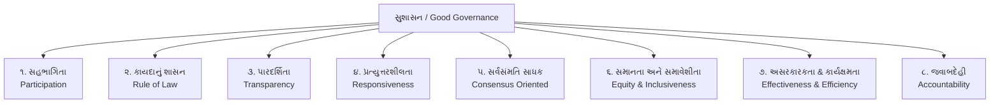

# જાહેર વહીવટ (Public Administration) - ભાગ ૪
## અમલદારશાહી (Bureaucracy), વહીવટી સુધારણા (ARC), સુશાસન, RTI, સિટિઝન ચાર્ટર અને કેન્દ્રીય સચિવાલય માળખું
### મેક્સ વેબરનો અમલદારશાહી સિદ્ધાંત, ૧મો & ૨મો ARC, નીતિ આયોગ, ગુડ ગવર્નન્સ, અરુણા રોય (MKSS) અને મંત્રાલય-વિભાગ વહીવટી શ્રેણી
### CCE Mains Group A (Paper-3 Section-3) & GPSC Class 1/2 Master Study Notes

---

## 📌 વિડિયો સંદર્ભ અને લેક્ચર માહિતી
* **વિડિયો સોર્સ:** [LearningPocket GPSC - જાહેર વહીવટ | Part-4 | Public Administration](https://www.youtube.com/live/68wzP1_wZxk?si=xHGF70uARYTCUVXa)
* **યુટ્યુબ વિડિયો ID:** `68wzP1_wZxk`
* **માર્ગદર્શક:** હેમંત શાહ સર (Hemant Shah Sir)
* **વિષય:** જાહેર વહીવટ અને શાસન (Public Administration and Governance)
* **CCE સિલેબસ મેપિંગ:**
  - વિભાગ ૩, મુદ્દો ૧ (`sec3_top1` - અમલદારશાહીની સંકલ્પના: મેક્સ વેબર)
  - વિભાગ ૩, મુદ્દો ૨ (`sec3_top2` - સુશાસન / Good Governance ના લક્ષણો)
  - વિભાગ ૩, મુદ્દો ૪ (`sec3_top4` - RTI Act 2005 & સિટિઝન ચાર્ટર)
  - વિભાગ ૩, મુદ્દો ૬ (`sec3_top6` - વહીવટી સુધારણા: ૧મો અને ૨મો ARC, નીતિ આયોગ)
* **ગુણભાર:** CCE Mains Group A માં જાહેર વહીવટ અને શાસનનો કુલ ભાર **૨૦ ગુણ** છે.

---

## 📚 પ્રકરણ અનુક્રમણિકા (Table of Contents)
1. [વહીવટી સુધારણાઓ અને કમિશનો (Administrative Reforms in India)](#1-વહીવટી-સુધારણાઓ-અને-કમિશનો)
   - પ્રથમ વહીવટી સુધારણા આયોગ (1st ARC ૧૯૬૬ - મોરારજી દેસાઈ / કે. હનુમંતૈયા)
   - દ્વિતીય વહીવટી સુધારણા આયોગ (2nd ARC ૨૦૦૫ - વીરપ્પા મોઈલી)
   - રાષ્ટ્રીય પોલીસ કમિશન (National Police Commission ૧૯૭૭) અને પોલીસ સુધારા
   - યોજના આયોગ વિ. નીતિ આયોગ (NITI Aayog ૨૦૧૫ - બોટમ-અપ અભિગમ)
2. [સુશાસન અને સ્માર્ટ ગવર્નન્સ (Good Governance & SMART Governance)](#2-સુશાસન-અને-સ્માર્ટ-ગવર્નન્સ)
   - વિશ્વ બેંક (World Bank ૧૯૯૨) નો રિપોર્ટ અને સંકલ્પના
   - સુશાસનના ૮ આધારસ્તંભ (8 Pillars of Good Governance)
   - SMART Governance નો અર્થ (Simple, Moral, Accountable, Responsive, Transparent)
3. [પારદર્શિતા અને જવાબદેહીના સાધનો (Tools of Accountability & Citizen-Centric Governance)](#3-પારદર્શિતા-અને-જવાબદેહીના-સાધનો)
   - માહિતીનો અધિકાર અધિનિયમ (RTI Act 2005): ઐતિહાસિક સંઘર્ષ (અરુણા રોય & MKSS)
   - RTI ની મહત્વની કલમો, સમયમર્યાદા (૩૦ દિવસ / ૪૮ કલાક) અને માહિતી આયોગો
   - સિટિઝન ચાર્ટર (Citizen's Charter): ૧૯૯૧ બ્રિટન (જોન મેજર), ભારતમાં સ્વીકૃતિ અને ૬ સિદ્ધાંતો
   - ઈ-ગવર્નન્સ (E-Governance): ડિજિટલ સાધનો અને નાગરિક સેવાઓ
4. [અમલદારશાહીની વિચારધારા - મેક્સ વેબર (Max Weber's Bureaucracy Theory)](#4-અમલદારશાહીની-વિચારધારા---મેક્સ-વેબર)
   - શબ્દાર્થ અને ઉદ્ભવ: વિન્સેન્ટ ડી ગોર્ને (૧૭૪૫)
   - મેક્સ વેબરનો 'આદર્શ અમલદારશાહી' (Ideal-Type Bureaucracy) મોડેલ
   - અમલદારશાહીના ૬ મુખ્ય લક્ષણો (Features)
   - અમલદારશાહીની મર્યાદાઓ: લાલફીતાશાહી (Red Tapism), જડતા અને અમાનવીય અભિગમ
5. [કેન્દ્રીય વહીવટી તંત્રનું માળખું (Central Administrative Machinery & Secretariat)](#5-કેન્દ્રીય-વહીવટી-તંત્રનું-માળખું)
   - રાજકીય કારોબારી (મંત્રીઓ) વિ. કાયમી કારોબારી (સનદી અધિકારીઓ)
   - મંત્રાલય (Ministry) અને વિભાગ (Department) નું વિભાજન
   - સેન્ટ્રલ સેક્રેટરિએટ (સચિવાલય) નો પદાનુક્રમ (Hierarchy: કેબિનેટ સચિવથી અંડર સેક્રેટરી)
   - નાણા મંત્રાલય (Ministry of Finance) ના ૬ મહત્વના વિભાગોનું વિશ્લેષણ
6. [CCE Mains પ્રશ્નોત્તરી (2 Marks & 5 Marks Model Answers)](#6-cce-mains-પ્રશ્નોત્તરી-model-answers)
7. [પરીક્ષાલક્ષી હાઈ-યીલ્ડ ૧૦ પ્રશ્નોત્તરી (MCQ Quiz with Explanations)](#7-પરીક્ષાલક્ષી-હાઈ-યીલ્ડ-૧૦-mcqs)

---

## 1. વહીવટી સુધારણાઓ અને કમિશનો

ભારત આઝાદ થયું ત્યારે તેનું વહીવટી માળખું 'પોલીસ રાજ્ય' (Police State - બ્રિટિશ કાળનો કાયદો-વ્યવસ્થા અને મહેસૂલ કેન્દ્રિત અભિગમ) જેવું હતું. સ્વતંત્ર ભારતમાં તેને લોકકલ્યાણકારી રાજ્ય (Welfare State) માં રૂપાંતરિત કરવા વહીવટી સુધારણા અનિવાર્ય બની.

### (A) પ્રથમ વહીવટી સુધારણા આયોગ (1st ARC - ૧૯૬૬)
* **સ્થાપના:** ૫ જાન્યુઆરી ૧૯૬૬ ના રોજ ભારત સરકાર દ્વારા રચના.
* **પ્રથમ અધ્યક્ષ:** **મોરારજી દેસાઈ** (માર્ચ ૧૯૬૭ માં મોરારજી દેસાઈ નાયબ વડાપ્રધાન બનતાં તેમના સ્થાને **કે. હનુમંતૈયા** અધ્યક્ષ બન્યા).
* **મુખ્ય હેતુ:** કેન્દ્ર સરકારના જાહેર વહીવટની કાર્યક્ષમતા વધારવી, નાણાકીય નિયંત્રણ સુદ્રઢ કરવું અને લોકોની ફરિયાદોના નિવારણ માટે સંસ્થાકીય વ્યવસ્થા ઊભી કરવી.
* **મહત્વપૂર્ણ ભલામણો:**
  - નાગરિકોની ફરિયાદો અને ભ્રષ્ટાચાર નિવારણ માટે સ્કેન્ડિનેવિયન 'ઓમ્બુડ્સમેન' ની તર્જ પર કેન્દ્રમાં **લોકપાલ (Lokpal)** અને રાજ્યોમાં **લોકાયુક્ત (Lokayukta)** ની રચના કરવી.
  - કેન્દ્રીય સચિવાલયમાં કાર્યોનું પુનર્ગઠન અને કામગીરી આધારિત બજેટ (Performance Budgeting) દાખલ કરવું.
  - કુલ ૨૦ અહેવાલો અને ૫૩૭ જેટલી ભલામણો રજૂ કરી.

### (B) દ્વિતીય વહીવટી સુધારણા આયોગ (2nd ARC - ૨૦૦૫)
* **સ્થાપના:** ૩૧ ઓગસ્ટ ૨૦૦૫ ના રોજ.
* **અધ્યક્ષ:** **વીરપ્પા મોઈલી (M. Veerappa Moily)** (ત્યારબાદ ૨૦૦૯ માં વી. રામચંદ્રન અધ્યક્ષ બન્યા).
* **ધ્યેય:** એક સક્રિય, પ્રતિભાવશીલ, પારદર્શક, જવાબદાર અને ટકાઉ શાસન વ્યવસ્થા માટેનો રોડમેપ તૈયાર કરવો.
* **મહત્વપૂર્ણ ૧૫ અહેવાલો (Key Reports):**
  1. *Right to Information: Master Key to Good Governance* (માહિતીનો અધિકાર - સુશાસનની માસ્ટર કી).
  2. *Unlocking Human Capital: Entitlements and Public Authorities (NREGA)*.
  3. *Crisis Management: From Despair to Hope* (આપત્તિ વ્યવસ્થાપન).
  4. *Ethics in Governance* (શાસનમાં નૈતિકતા - ભ્રષ્ટાચાર નાબૂદી, સનદી સેવકો માટે આચારસંહિતા).
  5. *Public Order* (જાહેર વ્યવસ્થા અને પોલીસ સુધારા).
  6. *Local Governance: An Inspiring Journey into the Future* (સ્થાનિક સ્વરાજ્ય).
  7. *Promoting E-Governance: The Smart Way Forward* (ઈ-ગવર્નન્સ).
  8. *Citizen Centric Administration: The Heart of Governance* (નાગરિક કેન્દ્રિત વહીવટ અને સિટિઝન ચાર્ટર).

### (C) રાષ્ટ્રીય પોલીસ કમિશન (National Police Commission - ૧૯૭૭)
* **સ્થાપના:** ૧૫ નવેમ્બર ૧૯૭૭ ના રોજ ધર્મવીરા (Dharma Vira) ની અધ્યક્ષતામાં સ્થાપના.
* સ્વતંત્ર ભારતનું આ સૌપ્રથમ રાષ્ટ્રીય પોલીસ પંચ હતું.
* તેણે પોલીસ તંત્રને રાજકીય દખલગીરીથી મુક્ત કરવા અને કલ્યાણકારી રાજ્ય અનુરૂપ નાગરિક-મિત્ર બનાવવા ૮ અહેવાલો આપ્યા (જેના આધારે ૨૦૦૬ માં સુપ્રીમ કોર્ટે 'પ્રકાશ સિંહ કેસ' માં ૭ ઐતિહાસિક નિર્દેશો આપ્યા).

### (D) નીતિ આયોગ (NITI Aayog - ૨૦૧૫)
* **સ્થાપના:** ૧ જાન્યુઆરી ૨૦૧૫ ના રોજ ૧૯૫૦ ના જૂના યોજના આયોગ (Planning Commission) ના સ્થાને.
* **પૂરું નામ:** National Institution for Transforming India.
* **અભિગમ બદલાવ:**
  - યોજના આયોગનો અભિગમ: **Top-Down** (દિલ્હીથી આદેશો અને યોજનાઓ થોપવી - 'One size fits all').
  - નીતિ આયોગનો અભિગમ: **Bottom-Up** (ગામડાં અને રાજ્યોની જરૂરિયાત મુજબ આયોજન - સહકારી સંઘવાદ / Cooperative Federalism).
* **માળખું:** અધ્યક્ષ = વડાપ્રધાન, ઉપાધ્યક્ષ (કેબિનેટ મંત્રી કક્ષા), CEO, અને તમામ રાજ્યોના મુખ્યમંત્રીઓ તથા UTs ના લેફ્ટનન્ટ ગવર્નર્સ ધરાવતી **ગવર્નિંગ કાઉન્સિલ (Governing Council)**.

---

## 2. સુશાસન અને સ્માર્ટ ગવર્નન્સ (Good Governance & SMART)

### (A) સંકલ્પનાનો ઉદ્ભવ
* ૧૯૭૦-૮૦ ના દાયકા સુધી માત્ર 'વહીવટ' (Administration - કાયદા મુજબ કામ ચલાવવું) શબ્દ ચાલતો હતો.
* ૧૯૯૨ માં વિશ્વ બેંક (World Bank) ના સીમાચિહ્નરૂપ અહેવાલ **"Governance and Development"** માં સૌપ્રથમ વખત **સુશાસન (Good Governance)** ની વૈશ્વિક વ્યાખ્યા આપવામાં આવી.
* **અર્થ:** દેશના આર્થિક અને સામાજિક સંસાધનોનું લોકહિત અને વિકાસ માટે પારદર્શક, ન્યાયી અને જવાબદાર સંચાલન એટલે સુશાસન.

### (B) સુશાસનના ૮ સ્તંભો (8 Core Pillars of Good Governance)
વિશ્વ બેંક અને UNDP અનુસાર સુશાસનના ૮ અનિવાર્ય લક્ષણો છે:



1. **સહભાગિતા (Participation):** નિર્ણયો લેવામાં તમામ નાગરિકો, ખાસ કરીને વંચિત વર્ગોની સીધી કે આડકતરી ભાગીદારી.
2. **કાયદાનું શાસન (Rule of Law):** કાયદા સમક્ષ સૌ સમાન, માનવાધિકારોનું રક્ષણ અને ન્યાયતંત્રની સ્વતંત્રતા.
3. **પારદર્શિતા (Transparency):** સરકારી નિર્ણયો અને માહિતી નાગરિકો માટે ખુલ્લી અને સુલભ હોવી.
4. **પ્રત્યુત્તરશીલતા (Responsiveness):** સરકારી તંત્ર નિશ્ચિત સમયમર્યાદામાં નાગરિકોની જરૂરિયાતો અને ફરિયાદોનો ઝડપી પ્રતિસાદ આપે.
5. **સર્વસંમતિ સાધક (Consensus Oriented):** સમાજના વિવિધ હિતધારકો વચ્ચે સંવાદ સાધીને સર્વોચ્ચ જનહિતનો સર્વસંમત માર્ગ શોધવો.
6. **સમાનતા અને સમાવેશીતા (Equity & Inclusiveness):** સમાજના છેવાડાના વ્યક્તિને પણ વિકાસની મુખ્યધારામાં સમાન તક મળે.
7. **અસરકારકતા અને કાર્યક્ષમતા (Effectiveness & Efficiency):** ઉપલબ્ધ સંસાધનોનો ઓછામાં ઓછા બગાડ સાથે મહત્તમ ઉપયોગ કરી ઉત્કૃષ્ટ પરિણામ મેળવવું.
8. **જવાબદેહી (Accountability):** સરકારી સંસ્થાઓ, અધિકારીઓ અને ચૂંટાયેલા પ્રતિનિધિઓ જનતા પ્રત્યે સંપૂર્ણ ઉત્તરદાયી હોય.

### (C) SMART Governance
સુશાસનને વ્યવહારમાં અમલમાં મૂકવા માટેનું આધુનિક સૂત્ર:
* **S - Simple (સરળ):** જટિલ કાયદાઓ અને લાલફીતાશાહી વગરની સરળ સરકારી પ્રક્રિયાઓ.
* **M - Moral (નૈતિક):** ભ્રષ્ટાચારમુક્ત, પ્રમાણિક અને મૂલ્યનિષ્ઠ વહીવટ.
* **A - Accountable (જવાબદાર):** પ્રત્યેક અધિકારી પોતાના કાર્ય અને નિર્ણયો માટે ઉત્તરદાયી હોય.
* **R - Responsive (પ્રત્યુત્તરશીલ):** નાગરિકોની સમસ્યાઓનું ઝડપી અને સંવેદનશીલ નિવારણ.
* **T - Transparent (પારદર્શક):** ખુલ્લી માહિતી વ્યવસ્થા અને જાહેર દેખરેખ.

---

## 3. પારદર્શિતા અને જવાબદેહીના સાધનો

### (A) માહિતીનો અધિકાર (RTI Act 2005) - જન આંદોલનથી કાયદા સુધી
* **ઐતિહાસિક પૃષ્ઠભૂમિ:**
  - ૧૯૯૦ ના દાયકામાં રાજસ્થાનના રાજસમંદ જિલ્લાના દેવડુંગરી ગામમાં **મજદૂર કિસાન શક્તિ સંગઠન (MKSS)** ની સ્થાપના થઈ.
  - પૂર્વ IAS અધિકારી **અરુણા રોય (Aruna Roy)**, નિખિલ ડે અને શંકર સિંઘે ગરીબ મજૂરો અને ખેડૂતોને તેમના દુષ્કાળ રાહતના મસ્ટર રોલ (હાજરી અને વેતન પત્રક) મેળવવા સંગઠિત કર્યા.
  - સૂત્ર: *"હમારા પૈસા, હમારા હિસાબ!"* અને *"જાણવાનો અધિકાર, જીવવાનો અધિકાર છે!"*
  - તેમણે ગામડે-ગામડે **'જનસુનાવણી' (Public Hearings)** શરૂ કરી ભ્રષ્ટાચાર ખુલ્લો પાડ્યો.
* **કાયદાકીય અમલ:**
  - રાજસ્થાન સરકારે ૨૦૦૦ માં રાજ્ય RTI કાયદો બનાવ્યો.
  - કેન્દ્ર સરકારે ૧૫ જૂન ૨૦૦૫ ના રોજ કાયદો પસાર કર્યો અને **૧૨ ઓક્ટોબર ૨૦૦૫** થી દેશભરમાં **માહિતી અધિકાર અધિનિયમ (RTI Act 2005)** સંપૂર્ણપણે લાગુ થયો.
* **મહત્વની જોગવાઈઓ:**
  - **સમયમર્યાદા (કલમ ૭):**
    * સામાન્ય માહિતી: અરજી મળ્યાના **૩૦ દિવસ** માં આપવી ફરજિયાત.
    * જો સહાયક જાહેર માહિતી અધિકારી (APIO) ને આપી હોય: **૩૫ દિવસ**.
    * જો માહિતી વ્યક્તિના **જીવન કે અંગત સ્વતંત્રતા (Life or Liberty)** સાથે સંકળાયેલી હોય: માત્ર **૪૮ કલાક** માં આપવી પડે!
  - **અપીલ વ્યવસ્થા:** પ્રથમ અપીલ ૩૦ દિવસમાં ઉપરી અધિકારી સમક્ષ; દ્વિતીય અપીલ ૯૦ દિવસમાં **માહિતી આયોગ (CIC / SIC)** સમક્ષ.
  - **દંડ:** વિલંબ માટે દરરોજ રૂ. ૨૫૦ (મહત્તમ રૂ. ૨૫,૦૦૦) નો અંગત દંડ PIO પર થઈ શકે છે.

### (B) સિટિઝન ચાર્ટર (Citizen's Charter - નાગરિક અધિકાર પત્ર)
* **ઉદ્ભવ:** ૧૯૯૧ માં યુનાઇટેડ કિંગડમ (UK) ના કન્ઝર્વેટિવ વડાપ્રધાન **જોન મેજર (John Major)** દ્વારા સૌપ્રથમ સિટિઝન ચાર્ટર કાર્યક્રમ શરૂ કરાયો.
* **ભારતમાં સ્વીકૃતિ:** મે ૧૯૯૭ માં યોજાયેલ તમામ રાજ્યોના મુખ્યમંત્રીઓની પરિષદમાં નાગરિક કેન્દ્રિત વહીવટ માટે સિટિઝન ચાર્ટર અપનાવવાનો ઠરાવ થયો.
* **અર્થ:** કોઈપણ સરકારી વિભાગ કે સંસ્થા નાગરિકોને કઈ કઈ સેવાઓ આપશે, તેની ગુણવત્તા કેવી હશે, કેટલા સમયમાં આપશે અને જો સેવા ન મળે તો ફરિયાદ ક્યાં કરવી — તેનો લેખિત સત્તાવાર દસ્તાવેજ એટલે **સિટિઝન ચાર્ટર**.
* **૬ મૂળભૂત સિદ્ધાંતો:**
  1. **ગુણવત્તા (Quality):** સેવાઓની ઉચ્ચ ગુણવત્તા જાળવવી.
  2. **પસંદગી (Choice):** નાગરિકોને વિવિધ વિકલ્પો પૂરા પાડવા.
  3. **માપદંડ (Standards):** સેવાઓ પૂર્ણ કરવાની ચોક્કસ સમયમર્યાદા જાહેર કરવી.
  4. **મૂલ્ય (Value):** પ્રજાના ટેક્સના નાણાંનું પૂરું વળતર આપવું.
  5. **જવાબદેહી (Accountability):** સેવા ન મળે તો જવાબદાર અધિકારીનું ઉત્તરદાયિત્વ નક્કી કરવું.
  6. **પારદર્શિતા (Transparency):** સેવાના નિયમો, ફી અને પદ્ધતિ જાહેરમાં પ્રદર્શિત કરવી.
* **નોંધ:** ભારતમાં સિટિઝન ચાર્ટર કાયદાકીય રીતે લાગુ કરવા યોગ્ય (Legally Enforceable) નથી, પરંતુ તે એક નૈતિક અને વહીવટી પ્રતિબદ્ધતા છે. ગુજરાતમાં તેના અમલ માટે **'સેવા સેતુ'** અને **'ગુજરાત સનદી સેવા અધિકાર અધિનિયમ (Right to Service Act)'** કાર્યરત છે.

### (C) ઈ-ગવર્નન્સ (E-Governance)
* માહિતી અને સંચાર તકનીક (ICT) ના ઉપયોગ દ્વારા સરકારી સેવાઓ નાગરિકોના ઘરઆંગણે પહોંચાડવી.
* દલાલો અને લાંચ-રુશ્વતની નાબૂદી (Faceless & Paperless governance).
* ઉદાહરણ: સુરત મહાનગરપાલિકાનું ઓનલાઇન સિટીઝન પોર્ટલ, ગુજરાતનું Digital Gujarat, ATVT અને i-Khedut પોર્ટલ.

---

## 4. અમલદારશાહીની વિચારધારા - મેક્સ વેબર

### (A) શબ્દાર્થ અને પૃષ્ઠભૂમિ
* **વ્યુત્પત્તિ:** ફ્રેન્ચ અર્થશાસ્ત્રી **વિન્સેન્ટ ડી ગોર્ને (Vincent de Gournay - ૧૭૪૫)** એ સૌપ્રથમ **Bureaucracy** શબ્દ પ્રયોજ્યો હતો.
  - ફ્રેન્ચ શબ્દ **`Bureau`** (ડેસ્ક, ટેબલ અથવા કચેરી) + ગ્રીક શબ્દ **`Kratos`** (શાસન/સત્તા) = **ડેસ્કનું શાસન / દફતરશાહી**.
* વિન્સેન્ટ ડી ગોર્નેએ ફ્રાન્સમાં અધિકારીઓની અતિશય દખલગીરીની આલોચના કરતા કહ્યું હતું: *"ફ્રાન્સમાં એક નવો રોગ ફેલાયો છે, જેને બ્યુરોમેનિયા કહેવાય છે!"*
* પરંતુ જર્મન સમાજશાસ્ત્રી **મેક્સ વેબર (Max Weber - ૧૮૬૪-૧૯૨૦)** એ અમલદારશાહીનો વૈજ્ઞાનિક અને સમાજશાસ્ત્રીય અભ્યાસ કરી તેને આધુનિક સંગઠન માટેનું સૌથી કાર્યક્ષમ તાર્કિક સાધન ગણાવ્યું.

### (B) મેક્સ વેબરનો 'આદર્શ અમલદારશાહી' (Ideal-Type Bureaucracy) મોડેલ
વેબર મુજબ મોટા પાયાના ઔદ્યોગિક અને સરકારી સંગઠનોનું સંચાલન કરવા માટે અમલદારશાહી અનિવાર્ય છે. તેના ૬ આધારસ્તંભ લક્ષણો છે:

| ક્રમ | મુખ્ય લક્ષણ | અર્થ અને વહીવટી મહત્વ |
| :---: | :--- | :--- |
| **૧** | **કાયદાકીય-તાર્કિક સત્તા (Legal-Rational Authority)** | સત્તા કોઈ વ્યક્તિ કે પરંપરામાં નહીં, પરંતુ કાયદા અને હોદ્દામાં રહેલી છે. અધિકારી કાયદાના દાયરામાં જ હુકમ કરી શકે. |
| **૨** | **કડક અધિકારશ્રેણી (Hierarchical Structure)** | ઉચ્ચ અધિકારીથી નિમ્ન સ્તર સુધી પિરામિડ જેવી શિસ્તબદ્ધ સાંકળ; પ્રત્યેક નિમ્ન પદ ઉચ્ચ પદના નિયંત્રણ અને નિરીક્ષણ હેઠળ હોય. |
| **૩** | **કાર્યાત્મક વિશેષીકરણ (Division of Labour)** | સંગઠનનું દરેક કાર્ય નિશ્ચિત વિભાગો અને નિષ્ણાતો વચ્ચે વહેંચાયેલું હોય. |
| **૪** | **લેખિત નિયમો અને રેકોર્ડ્સ (Written Rules & Files)** | તમામ વહીવટી નિર્ણયો, નીતિઓ અને આદેશો લેખિત નિયમો મુજબ લેવાય અને તેની સત્તાવાર ફાઇલો સાચવવામાં આવે. |
| **૫** | **બિન-વ્યક્તિગત સંબંધો (Impersonality)** | વહીવટમાં લાગણીઓ, પક્ષપાત, ભાઈ-ભત્રીજાવાદ કે અંગત સંબંધોને સ્થાન નથી. સૌ નાગરિકો સાથે નિયમ મુજબ સમાન વ્યવહાર. |
| **૬** | **યોગ્યતા આધારિત કારકિર્દી (Merit-based Career Structure)** | ભરતી ખુલ્લી સ્પર્ધા અને ટેકનિકલ લાયકાતના આધારે; નિશ્ચિત માસિક પગાર, પેન્શન અને પ્રમોશનની તકો. |

```
                     [કાયદાકીય-તાર્કિક સત્તા]
                                │
    ┌───────────────────────────┼───────────────────────────┐
[કડક અધિકારશ્રેણી]     [શ્રમ વિભાજન & વિશેષીકરણ]      [લેખિત નિયમો & ફાઇલો]
    │                           │                           │
[બિન-વ્યક્તિગત સંબંધો]    [મેરિટ આધારિત ભરતી]         [નિશ્ચિત પગાર & પેન્શન]
```

### (C) અમલદારશાહીની ટીકાઓ અને મર્યાદાઓ:
1. **લાલફીતાશાહી (Red Tapism):** ફાઇલો અને નિયમોની ઔપચારિકતામાં સમયનો ભારે બગાડ અને નિર્ણયોમાં અક્ષમ્ય વિલંબ.
2. **જડતા અને પરિવર્તનનો વિરોધ (Rigidity):** અધિકારીઓ નિયમોને સાધન નહીં પણ સાધ્ય (End in itself) માની લે છે, જેથી નવીનતા રૂંધાય છે.
3. **અમાનવીય વલણ (Dehumanisation):** લાગણીવિહીન યંત્રવત્ વહીવટને કારણે માનવીય સંવેદના અને કટોકટીમાં જરૂરી લવચીકતા મરી પરવારે છે.
4. **સત્તાનું કેન્દ્રીકરણ:** અમલદારશાહી પોતાની સત્તા અને ગુપ્તતા જાળવી રાખીને જનતાના પ્રતિનિધિઓ પર હાવી થવાનો પ્રયાસ કરે છે.

---

## 5. કેન્દ્રીય વહીવટી તંત્રનું માળખું

ભારતમાં સંસદીય લોકશાહી હોવાથી શાસન બે સ્તરે ચાલે છે:
1. **રાજકીય કારોબારી (Political Executive):** ચૂંટાયેલા મંત્રીઓ — કેબિનેટ મંત્રી, રાજ્ય મંત્રી, નાયબ મંત્રી (અસ્થાયી, ૫ વર્ષ માટે).
2. **કાયમી કારોબારી (Permanent Executive):** સનદી સેવકો / IAS અધિકારીઓ (નિવૃત્તિ વય ૬૦ વર્ષ સુધી કાયમી).

### (A) મંત્રાલય અને વિભાગ (Ministry & Department)
* કેન્દ્ર સરકારનું વહીવટી તંત્ર **મંત્રાલયો (Ministries)** માં વહેંચાયેલું છે.
* મંત્રાલયના રાજકીય વડા **કેબિનેટ મંત્રી** હોય છે.
* મોટા મંત્રાલયને કાર્યોની સરળતા માટે એક કે તેથી વધુ **વિભાગો (Departments)** માં વહેંચવામાં આવે છે. વિભાગના વહીવટી વડા **સચિવ (Secretary - વરિષ્ઠ IAS)** હોય છે.

### (B) કેન્દ્રીય સચિવાલય (Central Secretariat) નો પદાનુક્રમ
સચિવાલયમાં ફાઇલ નિમ્ન સ્તરથી ઉચ્ચ સ્તર સુધી પસાર થાય છે:

```
    [કેબિનેટ સચિવ / Cabinet Secretary]       ◄── દેશના સર્વોચ્ચ સિવિલ સેવક
                   │
         [સચિવ / Secretary]                  ◄── મંત્રાલય/વિભાગના વહીવટી વડા
                   │
    [વિશેષ / અધિક સચિવ / Addl. Secretary]
                   │
      [સંયુક્ત સચિવ / Joint Secretary]        ◄── વિંગ (Wing) ના વડા
                   │
      [ડિરેક્ટર / ઉપ સચિવ / Dy. Secretary]    ◄── ડિવિઝન (Division) ના વડા
                   │
     [અંડર સેક્રેટરી / Under Secretary]      ◄── બ્રાન્ચ (Branch) ના વડા
                   │
      [સેક્શન ઓફિસર / Section Officer]       ◄── સેક્શન (Section) ના વડા
                   │
    [આસિસ્ટન્ટ સેક્શન ઓફિસર / ASO & ક્લાર્ક]  ◄── ફાઇલની પ્રાથમિક નોંધણી
```

### (C) કેસ સ્ટડી: નાણા મંત્રાલય (Ministry of Finance) ના ૬ વિભાગો
હેમંત શાહ સરે લેક્ચરમાં સમજાવ્યા મુજબ નાણા મંત્રાલયનું કાર્યાત્મક વિભાજન:
1. **આર્થિક બાબતોનો વિભાગ (Department of Economic Affairs - DEA):** દેશનું વાર્ષિક કેન્દ્રીય અંદાજપત્ર (Budget) અને આર્થિક સર્વેક્ષણ (Economic Survey) તૈયાર કરે છે.
2. **ખર્ચ વિભાગ (Department of Expenditure):** વિવિધ મંત્રાલયોના સરકારી ખર્ચનું ઓડિટ અને નાણાકીય નિયંત્રણ કરે છે.
3. **મહેસૂલ વિભાગ (Department of Revenue):** તમામ પ્રત્યક્ષ કર (CBDT - ઇન્કમટેક્સ) અને અપ્રત્યક્ષ કર (CBIC - GST, કસ્ટમ્સ) ની વસૂલાત સંભાળે છે.
4. **નાણાકીય સેવાઓનો વિભાગ (Department of Financial Services - DFS):** દેશની તમામ સરકારી બેંકો (PSB), RBI ની નીતિઓ, પેન્શન અને વીમા ક્ષેત્રનું નિયમન કરે છે.
5. **DIPAM (વિનિવેશ અને જાહેર સંપત્તિ વ્યવસ્થાપન વિભાગ):** ખોટ કરતી સરકારી કંપનીઓનું ખાનગીકરણ અને શેર વેચાણ (Disinvestment) સંભાળે છે.
6. **જાહેર સાહસોનો વિભાગ (Department of Public Enterprises - DPE):** નવરત્ન, મહારત્ન અને મિનિરત્ન PSUs ના સંચાલન અને નફાકારકતાની સમીક્ષા કરે છે.

---

## 6. CCE Mains પ્રશ્નોત્તરી (Model Answers)

### પ્રશ્ન ૧ (૨ ગુણ): સુશાસન (Good Governance) ના કોઈપણ ચાર મુખ્ય લક્ષણો જણાવો.
**જવાબ:**
વિશ્વ બેંક અને UNDP અનુસાર સુશાસનના ચાર અગત્યના લક્ષણો:
1. **પારદર્શિતા (Transparency):** સરકારી નિર્ણયો અને પ્રક્રિયાઓ નાગરિકો માટે ખુલ્લી અને સરળ હોવી.
2. **જવાબદેહી (Accountability):** સરકારી અધિકારીઓ અને સંસ્થાઓ પ્રજા સમક્ષ પોતાના કાર્યો માટે ઉત્તરદાયી હોવા.
3. **કાયદાનું શાસન (Rule of Law):** પક્ષપાત વગર કાયદા સમક્ષ સમાનતા અને બંધારણીય અધિકારોનું રક્ષણ.
4. **પ્રત્યુત્તરશીલતા (Responsiveness):** નાગરિકોની જરૂરિયાતો અને ફરિયાદોનું નિયત સમયમર્યાદામાં નિવારણ કરવું.

---

### પ્રશ્ન ૨ (૨ ગુણ): સિટિઝન ચાર્ટર (Citizen's Charter) નો ઉદ્ભવ ક્યારે અને ક્યાં થયો હતો? તેનો મુખ્ય હેતુ શો છે?
**જવાબ:**
* **ઉદ્ભવ:** ૧૯૯૧ માં યુનાઇટેડ કિંગડમ (બ્રિટન) માં વડાપ્રધાન **જોન મેજર** દ્વારા સૌપ્રથમ સિટિઝન ચાર્ટર શરૂ કરવામાં આવ્યો હતો.
* **મુખ્ય હેતુ:** સરકારી વિભાગો દ્વારા નાગરિકોને આપવામાં આવતી સેવાઓના માપદંડ, ગુણવત્તા, સમયમર્યાદા અને ફરિયાદ નિવારણ પદ્ધતિ જાહેરમાં પ્રદર્શિત કરી વહીવટને નાગરિક-કેન્દ્રિત બનાવવો.

---

### પ્રશ્ન ૩ (૫ ગુણ): મેક્સ વેબરના 'આદર્શ અમલદારશાહી' (Ideal-Type Bureaucracy) ના સિદ્ધાંતના મુખ્ય લક્ષણો અને તેની મર્યાદાઓ ચર્ચો.
**જવાબ:**
**પ્રસ્તાવના:** જર્મન સમાજશાસ્ત્રી મેક્સ વેબરે અમલદારશાહીને મોટા સંગઠનોના કાર્યક્ષમ સંચાલન માટે કાયદાકીય-તાર્કિક સત્તા પર આધારિત એક આદર્શ વ્યવસ્થા ગણાવી હતી.

**મુખ્ય લક્ષણો (Key Features):**
1. **કાયદાકીય-તાર્કિક સત્તા:** સત્તા વ્યક્તિગત ઈચ્છામાં નહીં પણ પદ અને કાયદામાં સ્થાપિત હોય છે.
2. **ચોક્કસ અધિકારશ્રેણી:** ઉચ્ચથી નિમ્ન સ્તર સુધી સુવ્યવસ્થિત સોપાનક્રમ, જ્યાં ઉપરી તાબાના કર્મચારી પર નિયંત્રણ રાખે છે.
3. **શ્રમ વિભાજન અને વિશેષીકરણ:** કાર્યોનું સુસ્પષ્ટ વિભાજન અને લાયકાત મુજબ સોંપણી.
4. **લેખિત નિયમો અને દસ્તાવેજો:** તમામ વહીવટ લેખિત નિયમો મુજબ ચાલે છે અને ફાઇલોમાં સત્તાવાર નોંધ રાખવામાં આવે છે.
5. **બિન-વ્યક્તિગત સંબંધો (Impersonality):** અધિકારી અંગત પક્ષપાત કે લાગણીઓ વિના માત્ર નિયમ મુજબ તટસ્થ વર્તન કરે છે.
6. **મેરિટ આધારિત કારકિર્દી:** સ્પર્ધાત્મક પરીક્ષાથી ભરતી, નિશ્ચિત વેતન અને પ્રમોશનની વ્યવસ્થા.

**મર્યાદાઓ (Criticisms):**
* **લાલફીતાશાહી (Red Tapism):** ફાઇલો અને નિયમોની જાળમાં નિર્ણયોમાં ભારે વિલંબ.
* **જડતા:** અધિકારીઓ પરિસ્થિતિ મુજબ લવચીક બનવાને બદલે નિયમોને જ અંતિમ માની લે છે.
* **માનવીય સંવેદનાનો અભાવ:** લાગણીવિહીન વલણને કારણે નાગરિકોની વાસ્તવિક મુશ્કેલીઓ પ્રત્યે ઉદાસીનતા પેદા થાય છે.

**નિષ્કર્ષ:** મર્યાદાઓ છતાં આધુનિક લોકશાહી રાજ્યમાં સ્થિરતા અને કાયદાનું શાસન જાળવવા અમલદારશાહી અનિવાર્ય માળખું છે.

---

### પ્રશ્ન ૪ (૫ ગુણ): ભારતમાં માહિતીનો અધિકાર અધિનિયમ (RTI Act 2005) પાછળના જન આંદોલનની ભૂમિકા અને તેની મહત્વની જોગવાઈઓ સમજાવો.
**જવાબ:**
**પ્રસ્તાવના:** ભારતમાં RTI Act 2005 એ માત્ર સંસદીય કાયદો નથી, પરંતુ રાજસ્થાનના છેવાડાના ગામડાઓમાંથી શરૂ થયેલા પ્રજાકીય આંદોલનનું ઐતિહાસિક પરિણામ છે.

**જન આંદોલનની પૃષ્ઠભૂમિ:**
* ૧૯૯૦ ના દાયકામાં પૂર્વ IAS **અરુણા રોય** ના નેતૃત્વ હેઠળ **મજદૂર કિસાન શક્તિ સંગઠન (MKSS)** દ્વારા રાજસ્થાનના દેવડુંગરી ગામથી આંદોલન શરૂ થયું.
* મજૂરોને દુષ્કાળ રાહતમાં ઓછું વેતન મળતું હોવાથી તેમણે માસ્ટર રોલ (હાજરી પત્રક) માંગ્યા, પરંતુ સરકારી ગુપ્તતાના ઓઠા હેઠળ નકારી કઢાયા.
* MKSS એ ગામડે-ગામડે **'જનસુનાવણી'** કરી *"હમારા પૈસા, હમારા હિસાબ"* ના નારા સાથે ભ્રષ્ટાચાર ખુલ્લો પાડ્યો. આ આંદોલનના પરિણામે ૧૨ ઓક્ટોબર ૨૦૦૫ થી રાષ્ટ્રવ્યાપી RTI કાયદો અમલી બન્યો.

**મહત્વની જોગવાઈઓ:**
1. **માહિતી મેળવવાનો અધિકાર:** પ્રત્યેક નાગરિક સરકારી કામ, દસ્તાવેજો, નમૂનાઓ અને રેકોર્ડ્સ ચકાસી શકે છે.
2. **નિશ્ચિત સમયમર્યાદા (કલમ ૭):**
   - સામાન્ય અરજી માટે: **૩૦ દિવસ**.
   - APIO મારફત: **૩૫ દિવસ**.
   - જીવન અને અંગત સ્વતંત્રતા (Life/Liberty) સંબંધિત: માત્ર **૪૮ કલાક**.
3. **સંસ્થાકીય માળખું:** કેન્દ્રમાં **CIC** અને રાજ્યોમાં **SIC** ની સ્થાપના.
4. **દંડની જોગવાઈ:** બિનજરૂરી વિલંબ માટે જાહેર માહિતી અધિકારી (PIO) પર પ્રતિ દિવસ રૂ. ૨૫૦ (મહત્તમ રૂ. ૨૫,૦૦૦) નો અંગત દંડ.

**નિષ્કર્ષ:** RTI એ ભારતમાં 'ગુપ્તતાની સંસ્કૃતિ' ને 'પારદર્શિતા અને જવાબદેહીની સંસ્કૃતિ' માં ફેરવવાનું સૌથી સબળ સાધન સાબિત થયું છે.

---

## 7. પરીક્ષાલક્ષી હાઈ-યીલ્ડ ૧૦ MCQs

### ૧. વિશ્વમાં સૌપ્રથમ વખત "Bureaucracy" (અમલદારશાહી / દફતરશાહી) શબ્દનો પ્રયોગ કોના દ્વારા કરવામાં આવ્યો હતો?
* (A) મેક્સ વેબર (Max Weber)
* (B) વિન્સેન્ટ ડી ગોર્ને (Vincent de Gournay)
* (C) હેનરી ફેયોલ
* (D) વૂડ્રો વિલ્સન  
**જવાબ: (B) વિન્સેન્ટ ડી ગોર્ને (Vincent de Gournay)**  
*સમજૂતી:* ૧૭૪૫ માં ફ્રેન્ચ અર્થશાસ્ત્રી વિન્સેન્ટ ડી ગોર્નેએ ફ્રેન્ચ શબ્દ 'Bureau' (ટેબલ/કચેરી) અને ગ્રીક શબ્દ 'Kratos' (શાસન) મેળવીને Bureaucracy શબ્દ બનાવ્યો હતો.

---

### ૨. મેક્સ વેબરના મતે આધુનિક અમલદારશાહી કયા પ્રકારની સત્તા પર આધારિત હોય છે?
* (A) પરંપરાગત સત્તા (Traditional Authority)
* (B) ચમત્કારી સત્તા (Charismatic Authority)
* (C) કાયદાકીય-તાર્કિક સત્તા (Legal-Rational Authority)
* (D) ધાર્મિક સત્તા (Theocratic Authority)  
**જવાબ: (C) કાયદાકીય-તાર્કિક સત્તા (Legal-Rational Authority)**  
*સમજૂતી:* વેબર મુજબ આધુનિક સંગઠનોમાં સત્તા કોઈ વ્યક્તિ કે પરંપરામાં નહીં પણ બંધારણ, કાયદા અને લેખિત હોદ્દામાં સ્થાપિત હોય છે જેને Legal-Rational Authority કહે છે.

---

### ૩. ૧૯૬૬ માં સ્થપાયેલ ભારતના 'પ્રથમ વહીવટી સુધારણા આયોગ' (1st ARC) ના પ્રથમ અધ્યક્ષ કોણ હતા?
* (A) કે. હનુમંતૈયા
* (B) મોરારજી દેસાઈ
* (C) વીરપ્પા મોઈલી
* (D) એલ. એમ. સિંઘવી  
**જવાબ: (B) મોરારજી દેસાઈ**  
*સમજૂતી:* ૫ જાન્યુઆરી ૧૯૬૬ ના રોજ રચાયેલ પ્રથમ ARC ના અધ્યક્ષ મોરારજી દેસાઈ હતા. ૧૯૬૭ માં તેઓ નાયબ વડાપ્રધાન બનતાં કે. હનુમંતૈયા અધ્યક્ષ બન્યા હતા.

---

### ૪. ૨૦૦૫ માં રચાયેલ 'દ્વિતીય વહીવટી સુધારણા આયોગ' (2nd ARC) ના અધ્યક્ષ કોણ હતા?
* (A) મોરારજી દેસાઈ
* (B) વીરપ્પા મોઈલી (M. Veerappa Moily)
* (C) વાય. વી. રેડ્ડી
* (D) અરુણા રોય  
**જવાબ: (B) વીરપ્પા મોઈલી (M. Veerappa Moily)**  
*સમજૂતી:* ઓગસ્ટ ૨૦૦૫ માં વીરપ્પા મોઈલીની અધ્યક્ષતામાં ૨મો ARC રચાયો હતો, જેણે RTI, સુશાસન, ઈ-ગવર્નન્સ અને વહીવટી નૈતિકતા પર ૧૫ ઐતિહાસિક અહેવાલો આપ્યા હતા.

---

### ૫. વિશ્વમાં સૌપ્રથમ વખત ૧૯૯૧ માં 'સિટિઝન ચાર્ટર' (Citizen's Charter) કાર્યક્રમ કયા દેશમાં અને કયા વડાપ્રધાન દ્વારા શરૂ કરાયો હતો?
* (A) યુએસએ - બિલ ક્લિન્ટન
* (B) યુનાઇટેડ કિંગડમ (UK) - જોન મેજર (John Major)
* (C) ફ્રાન્સ - ફ્રાન્કોઇસ મિથેરાન્ડ
* (D) ભારત - પી. વી. નરસિંહ રાવ  
**જવાબ: (B) યુનાઇટેડ કિંગડમ (UK) - જોન મેજર (John Major)**  
*સમજૂતી:* ૧૯૯૧ માં બ્રિટિશ વડાપ્રધાન જોન મેજરે નાગરિક કેન્દ્રિત સેવાઓ સુનિશ્ચિત કરવા સિટિઝન ચાર્ટરની શરૂઆત કરી હતી.

---

### ૬. ભારતમાં RTI કાયદો ઘડવા માટે રાજસ્થાનમાં જન આંદોલન ચલાવનાર પૂર્વ IAS અધિકારી અને સંસ્થાનું નામ શું છે?
* (A) મેધા પાટકર - નર્મદા બચાવો આંદોલન
* (B) અરુણા રોય - મજદૂર કિસાન શક્તિ સંગઠન (MKSS)
* (C) અન્ના હજારે - ભ્રષ્ટાચાર વિરોધી આંદોલન
* (D) કિરણ બેદી - ઇન્ડિયા અગેઇન્સ્ટ કરપ્શન  
**જવાબ: (B) અરુણા રોય - મજદૂર કિસાન શક્તિ સંગઠન (MKSS)**  
*સમજૂતી:* અરુણા રોય અને MKSS એ રાજસ્થાનના દેવડુંગરી ગામથી "હમારા પૈસા, હમારા હિસાબ" સૂત્ર સાથે જનસુનાવણી ચલાવી RTI નો પાયો નાખ્યો હતો.

---

### ૭. માહિતીનો અધિકાર અધિનિયમ (RTI Act 2005) હેઠળ જો માહિતી કોઈ વ્યક્તિના 'જીવન અથવા અંગત સ્વતંત્રતા' (Life or Liberty) સાથે સંબંધિત હોય, તો કેટલા સમયમાં આપવી ફરજિયાત છે?
* (A) ૨૪ કલાક
* (B) ૪૮ કલાક
* (C) ૭ દિવસ
* (D) ૩૦ દિવસ  
**જવાબ: (B) ૪૮ કલાક**  
*સમજૂતી:* કલમ ૭(૧) મુજબ જો માહિતી વ્યક્તિના જીવન કે સ્વાતંત્ર્ય સંબંધિત હોય તો અરજી મળ્યાના ૪૮ કલાકમાં પૂરી પાડવી ફરજિયાત છે (સામાન્ય માહિતી ૩૦ દિવસમાં).

---

### ૮. 'SMART Governance' સંકલ્પનામાં અક્ષર 'M' નો અર્થ શું થાય છે?
* (A) Modern (આધુનિક)
* (B) Moral (નૈતિક)
* (C) Measurable (માપી શકાય તેવું)
* (D) Mechanized (યાંત્રિક)  
**જવાબ: (B) Moral (નૈતિક)**  
*સમજૂતી:* SMART એટલે Simple (સરળ), Moral (નૈતિક), Accountable (જવાબદાર), Responsive (પ્રત્યુત્તરશીલ) અને Transparent (પારદર્શક).

---

### ૯. કેન્દ્રીય નાણા મંત્રાલય (Ministry of Finance) નો કયો વિભાગ દેશનું વાર્ષિક અંદાજપત્ર (Union Budget) તૈયાર કરવાની મુખ્ય જવાબદારી સંભાળે છે?
* (A) મહેસૂલ વિભાગ (Department of Revenue)
* (B) આર્થિક બાબતોનો વિભાગ (Department of Economic Affairs - DEA)
* (C) ખર્ચ વિભાગ (Department of Expenditure)
* (D) નાણાકીય સેવાઓનો વિભાગ (Department of Financial Services)  
**જવાબ: (B) આર્થિક બાબતોનો વિભાગ (Department of Economic Affairs - DEA)**  
*સમજૂતી:* DEA નો બજેટ ડિવિઝન દર વર્ષે સંસદમાં રજૂ થનારું કેન્દ્રીય બજેટ અને આર્થિક સર્વેક્ષણ તૈયાર કરે છે.

---

### ૧૦. ભારત સરકારના કેન્દ્રીય સચિવાલય (Central Secretariat) માં વહીવટી પદાનુક્રમમાં દેશના સર્વોચ્ચ સનદી સેવક (Highest Civil Servant) કોણ હોય છે?
* (A) ગૃહ સચિવ (Home Secretary)
* (B) પ્રધાનમંત્રીના અગ્ર સચિવ (Principal Secretary to PM)
* (C) કેબિનેટ સચિવ (Cabinet Secretary)
* (D) વિદેશ સચિવ (Foreign Secretary)  
**જવાબ: (C) કેબિનેટ સચિવ (Cabinet Secretary)**  
*સમજૂતી:* કેબિનેટ સચિવ એ ભારતીય વહીવટી તંત્રના સર્વોચ્ચ વડા, સિવિલ સર્વિસ બોર્ડના અધ્યક્ષ અને પ્રધાનમંત્રી તથા કેબિનેટના મુખ્ય વહીવટી સલાહકાર છે.
