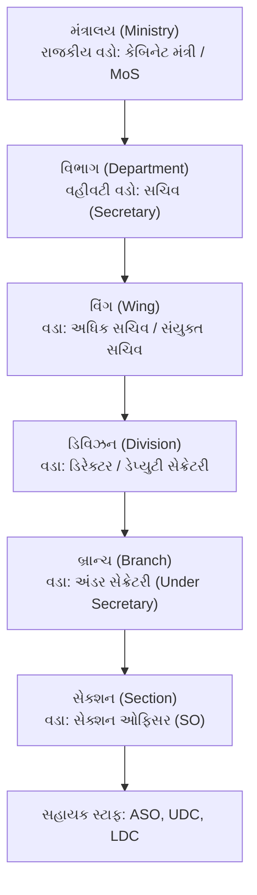
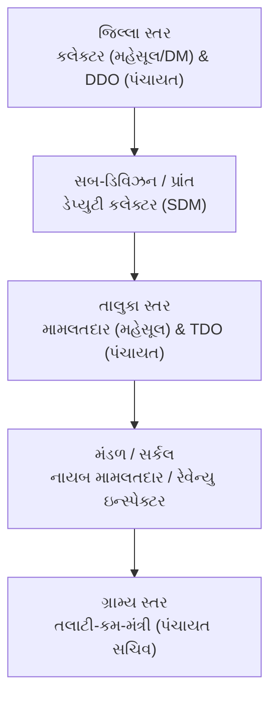

# જાહેર વહીવટ (Public Administration) | ભાગ - ૫
## કેન્દ્રીય અને રાજ્ય વહીવટી માળખું, પોર્ટફોલિયો સિસ્ટમ, ગૌણ વિધાન (Delegated Legislation) અને લાભનું પદ (Office of Profit)

> **સંદર્ભ વ્યાખ્યાન:** LearningPocket GPSC - હેમંત શાહ સર (*Part-5: Public Administration | PSI | GPSC | Jaher Vahivat in Gujarati*)  
> **વિડિયો લિંક:** [https://www.youtube.com/live/dgSSHGrnFEc](https://www.youtube.com/live/dgSSHGrnFEc)  
> **ઉપયોગીતા:** GSSSB CCE Mains Group A (Paper-3: જાહેર વહીવટ અને શાસન), GPSC Class 1/2 Mains, PSI Mains.

---

## અનુક્રમણિકા
1. [કેન્દ્રીય સચિવાલય અને મંત્રાલયનું આંતરિક સંગઠન માળખું](#૧-કેન્દ્રીય-સચિવાલય-અને-મંત્રાલયનું-આંતરિક-સંગઠન-માળખું)
2. [લેટરલ એન્ટ્રી (Lateral Entry) વિવાદ અને ACC](#૨-લેટરલ-એન્ટ્રી-lateral-entry-વિવાદ-અને-acc)
3. [પોર્ટફોલિયો સિસ્ટમ અને કેબિનેટ સચિવનો ઐતિહાસિક ઉદ્ભવ](#૩-પોર્ટફોલિયો-સિસ્ટમ-અને-કેબિનેટ-સચિવનો-ઐતિહાસિક-ઉદ્ભવ)
4. [રાજ્ય વહીવટી તંત્ર: મુખ્ય સચિવ, સચિવાલય વિ. નિર્દેશાલય](#૪-રાજ્ય-વહીવટી-તંત્ર-મુખ્ય-સચિવ-સચિવાલય-વિ-નિર્દેશાલય)
5. [જિલ્લા, તાલુકા અને ગ્રામીણ વહીવટી પદાનુક્રમ (લાઈન વિ. સ્ટાફ)](#૫-જિલ્લા-તાલુકા-અને-ગ્રામીણ-વહીવટી-પદાનુક્રમ)
6. [કાયદાઓનો પદાનુક્રમ, કાનૂની પ્રણાલીઓ અને ગૌણ વિધાન (Delegated Legislation)](#૬-કાયદાઓનો-પદાનુક્રમ-અને-ગૌણ-વિધાન)
7. [બંધારણીય ન્યાયશાસ્ત્ર: અનુચ્છેદ ૧૩ અને અદાલતી સિદ્ધાંતો](#૭-બંધારણીય-ન્યાયશાસ્ત્ર-અનુચ્છેદ-૧૩-અને-સિદ્ધાંતો)
8. [લાભનું પદ (Office of Profit) - બંધારણીય જોગવાઈઓ અને ૨૦૦૬ નો વિવાદ](#૮-લાભનું-પદ-office-of-profit)
9. [CCE Mains મોડેલ પ્રશ્નોત્તરો (૨ અને ૫ ગુણ)](#૯-cce-mains-મોડેલ-પ્રશ્નોત્તરો)
10. [૧૦ હાઈ-યીલ્ડ MCQs (વિસ્તૃત સમજૂતી સાથે)](#૧૦-હાઈ-યીલ્ડ-mcqs)

---

## ૧. કેન્દ્રીય સચિવાલય અને મંત્રાલયનું આંતરિક સંગઠન માળખું

ભારત સરકારમાં વહીવટી નિર્ણયોનું કેન્દ્રબિંદુ **કેન્દ્રીય સચિવાલય (Central Secretariat)** છે. સચિવાલય એ મંત્રાલયો અને વિભાગોનો સમૂહ છે જે સરકારની નીતિઓ ઘડવાનું કાર્ય કરે છે.

### 🏛️ મંત્રાલયનું સંગઠનાત્મક વિભાજન (પદાનુક્રમ)

| વહીવટી સ્તર | સત્તાવાર વડા (Officer In-Charge) | મુખ્ય ભૂમિકા / કાર્યો |
| :--- | :--- | :--- |
| **૧. મંત્રાલય (Ministry)** | કેબિનેટ મંત્રી (રાજકીય વડા) | સમગ્ર મંત્રાલયની નીતિ અને સંસદ પ્રત્યે સામૂહિક ઉત્તરદાયિત્વ. |
| **૨. વિભાગ (Department)** | સચિવ (Secretary - IAS) | મંત્રીના મુખ્ય વહીવટી સલાહકાર, વિભાગીય વહીવટના સર્વોચ્ચ વડા. |
| **૩. વિંગ (Wing)** | અધિક સચિવ (Addl. Sec.) / સંયુક્ત સચિવ (Joint Sec.) | વિભાગના ચોક્કસ મોટા ક્ષેત્ર (દા.ત. પોષણ વિંગ, બજેટ વિંગ) નું સ્વતંત્ર સંચાલન. |
| **૪. ડિવિઝન (Division)** | ડિરેક્ટર (Director) / ડેપ્યુટી સેક્રેટરી (Deputy Sec.) | વિંગ હેઠળના ચોક્કસ વિષયનું વિશ્લેષણ અને નીતિગત ડ્રાફ્ટિંગ. |
| **૫. બ્રાન્ચ (Branch)** | અંડર સેક્રેટરી (Under Secretary) | ડિવિઝનનું કાર્યકારી એકમ; ફાઇલોની ચકાસણી અને વહીવટી મંજૂરી. |
| **૬. સેક્શન (Section)** | સેક્શન ઓફિસર (Section Officer - SO) | ફાઇલોનો પ્રાથમિક નિકાલ, નિયમોની ચકાસણી અને દૈનિક કારભારી કામગીરી. |
| **૭. સહાયક કર્મચારીઓ** | ASO, UDC, LDC (SSC CHSL દ્વારા) | નોંધ લખવી (Noting), ડ્રાફ્ટિંગ અને ફાઇલ મેનેજમેન્ટ. |

---

## ૨. લેટરલ એન્ટ્રી (Lateral Entry) વિવાદ અને ACC

### 🔍 લેટરલ એન્ટ્રી શું છે?
* સામાન્ય રીતે સચિવાલયમાં સંયુક્ત સચિવ (JS), ડિરેક્ટર અને ડેપ્યુટી સેક્રેટરી જેવા ઉચ્ચ પદો પર સિવિલ સર્વિસ (UPSC CSE - IAS/IPS/IRS વગેરે) માંથી પ્રમોશન પામીને અધિકારીઓ પહોંચે છે (લગભગ ૧૫-૨૦ વર્ષની સેવા બાદ).
* **લેટરલ એન્ટ્રી (Lateral Entry):** સરકાર દ્વારા બહારના વિષય-નિષ્ણાતો (ખાનગી ક્ષેત્ર, બિન-સરકારી સંસ્થાઓ, શિક્ષણવિદો) ની UPSC પરીક્ષા આપ્યા વગર સીધા જ સંયુક્ત સચિવ કે ડિરેક્ટર તરીકે ૩ થી ૫ વર્ષના કરાર આધારિત (Contractual) નિમણૂક કરવાની પદ્ધતિ.

### ⚖️ પક્ષ અને વિપક્ષમાં દલીલો
* **સમર્થનમાં દલીલો (પક્ષ):**
  1. આધુનિક સમયમાં નાણાં, સાયબર સિક્યોરિટી, એવિએશન જેવા ક્ષેત્રોમાં જનરલિસ્ટ (સામાન્ય વહીવટકર્તા) કરતાં **સુપર-સ્પેશિયાલિસ્ટ (તજજ્ઞ)** જ્ઞાન જરૂરી છે.
  2. સરકારી વહીવટમાં વ્યાવસાયિક કાર્યક્ષમતા અને નવીન વિચારસરણી દાખલ થાય છે.
  3. ૨જા ARC (૨૦૦૫) અને નીતિ આયોગે પણ ઉચ્ચ સ્તરે તજજ્ઞોના સમાવેશની ભલામણ કરી હતી.
* **વિરોધમાં દલીલો (વિપક્ષ):**
  1. બંધારણીય અનામત (SC/ST/OBC) ના નિયમો લાગુ કરવામાં મુશ્કેલી પડે છે.
  2. વર્ષોથી મહેનત કરી કેડરમાં પ્રમોશનની રાહ જોતા સનદી સેવકોનું મનોબળ તૂટે છે.
  3. ખાનગી હિતોનો ટકરાવ (Conflict of Interest) થવાની સંભાવના રહે છે.

### 🏛️ Appointments Committee of the Cabinet (ACC)
* કેન્દ્ર સરકારના તમામ ઉચ્ચ પદો (સંયુક્ત સચિવ અને તેથી ઉપર, બેંક ચેરમેન, સેના વડાઓ) ની નિમણૂક **કેબિનેટની નિમણૂક સમિતિ (ACC)** દ્વારા થાય છે.
* **સભ્યો:** વડાપ્રધાન (અધ્યક્ષ) અને કેન્દ્રીય ગૃહમંત્રી.

---

## ૩. પોર્ટફોલિયો સિસ્ટમ અને કેબિનેટ સચિવનો ઐતિહાસિક ઉદ્ભવ

### 📜 પોર્ટફોલિયો સિસ્ટમ (Portfolio System)
* **પ્રણેતા:** ભારતના પ્રથમ વાઇસરોય **લોર્ડ કેનિંગ (Lord Canning)** દ્વારા **૧૮૫૯** માં શરૂ કરાઈ અને **ભારતીય પરિષદ અધિનિયમ ૧૮૬૧** દ્વારા તેને કાનૂની માન્યતા અપાઈ.
* **અર્થ:** વાઇસરોયની કારોબારી પરિષદના દરેક સભ્યને એક કે વધુ ચોક્કસ સરકારી ખાતાઓ (Departments - જેમ કે નાણાં, ગૃહ, લશ્કર) ની સ્વતંત્ર જવાબદારી સોંપવામાં આવી.
* પરિષદના સભ્ય પોતાના ખાતાના સામાન્ય નિર્ણયો પોતે જ લઈ શકતા, માત્ર મહત્વના કે નીતિગત પ્રશ્નો વાઇસરોય સમક્ષ રજૂ થતા. આ પ્રથા આજના **મંત્રાલય (Ministry / Portfolio)** વ્યવસ્થાનો પાયો બની.

### 👑 કેબિનેટ સચિવ (Cabinet Secretary)
* **ઉદ્ભવ:** બ્રિટિશ કાળમાં વાઇસરોયના અંગત સચિવ (Private Secretary to Viceroy) ની જગ્યાએથી કાળક્રમે આ પદ વિકસિત થયું. સ્વતંત્ર ભારતમાં એન. ગોપાલાસ્વામી આયંગર સમિતિ (૧૯૪૯) એ કેબિનેટ સચિવાલયના પુનર્ગઠનની ભલામણ કરી.
* **હોદ્દાનું મહત્વ:**
  * ભારત સરકારના **સર્વોચ્ચ સનદી સેવક (Highest Ranking Civil Servant)**.
  * વડાપ્રધાન અને કેન્દ્રીય કેબિનેટના મુખ્ય વહીવટી સલાહકાર.
  * કેબિનેટ સચિવાલય (Cabinet Secretariat) ના વહીવટી વડા.
  * સિવિલ સર્વિસીસ બોર્ડ (Civil Services Board) ના પદેન અધ્યક્ષ.
  * તમામ રાજ્યોના મુખ્ય સચિવોની વાર્ષિક કોન્ફરન્સના અધ્યક્ષ.

---

## ૪. રાજ્ય વહીવટી તંત્ર: મુખ્ય સચિવ, સચિવાલય વિ. નિર્દેશાલય

### 🌟 રાજ્યના મુખ્ય સચિવ (Chief Secretary - CS)
* રાજ્યના વહીવટી તંત્રના સર્વોચ્ચ વડા એટલે **મુખ્ય સચિવ**.
* **મુખ્ય કાર્યો અને જવાબદારીઓ:**
  1. **મુખ્યમંત્રીના મુખ્ય સલાહકાર:** તમામ નીતિગત અને વહીવટી બાબતોમાં મુખ્યમંત્રીને માર્ગદર્શન આપે છે.
  2. **રાજ્ય કેબિનેટના સચિવ:** કેબિનેટ બેઠકોનો એજન્ડા તૈયાર કરવો અને નિર્ણયોની મિનિટ્સ નોંધવી.
  3. **રાજ્ય સિવિલ સર્વિસના વડા:** રાજ્યના તમામ IAS, IPS અને રાજ્ય સેવાના અધિકારીઓનું નેતૃત્વ.
  4. **મુખ્ય સંયોજક (Chief Coordinator):** રાજ્યના જુદા જુદા વિભાગો વચ્ચે સંકલન સાધવું.
  5. **કટોકટી સંચાલક (Crisis Administrator):** કુદરતી આપત્તિ કે કાયદો-વ્યવસ્થાની કટોકટીમાં સમગ્ર રાજ્યના વહીવટનું કમાન્ડિંગ કરવું.

### ⚖️ સચિવાલય (Secretariat) વિ. નિર્દેશાલય (Directorate / કચેરીના વડા)

| સરખામણીના મુદ્દા | સચિવાલય (Secretariat) | નિર્દેશાલય / કમિશનરેટ (Directorate) |
| :--- | :--- | :--- |
| **પ્રકૃતિ** | સ્ટાફ એજન્સી (Staff Agency) | લાઇન એજન્સી (Line Agency) |
| **મુખ્ય કાર્ય** | **નીતિ નિર્માણ (Policy Formulation)** અને બજેટ મંજૂરી. | **નીતિ અમલીકરણ (Policy Implementation)** અને ફિલ્ડ સુપરવિઝન. |
| **વડા** | સચિવ (Secretary - IAS) | નિયામક / કમિશનર (Director / Commissioner) |
| **સ્થાન** | પાટનગર (ગાંધીનગર - સ્વર્ણિમ સંકુલ / સચિવાલય). | રાજ્યના વિવિધ વડા મથકો (દા.ત. જૂના સચિવાલય, અમદાવાદ, વડોદરા). |
| **જવાબદેહી** | મંત્રી અને ધારાસભા પ્રત્યે સીધી નીતિગત જવાબદારી. | સચિવાલય પ્રત્યે વહીવટી અમલવારી માટે જવાબદાર. |

---

## ૫. જિલ્લા, તાલુકા અને ગ્રામીણ વહીવટી પદાનુક્રમ

રાજ્યનું વહીવટી તંત્ર છેવાડાના નાગરિક સુધી પહોંચવા માટે ત્રિસ્તરીય માળખામાં વહેંચાયેલું છે:

### 📋 વહીવટી સ્તરો અને અધિકારીઓની સરખામણી

| વહીવટી સ્તર | મહેસૂલ & મેજિસ્ટ્રિયલ પાંખ | પંચાયત & વિકાસ પાંખ | વિશેષતા / નોંધ |
| :--- | :--- | :--- | :--- |
| **જિલ્લો (District)** | **જિલ્લા કલેક્ટર & DM** | **જિલ્લા વિકાસ અધિકારી (DDO)** | કલેક્ટર મહેસૂલ, શાંતિ અને કાયદો સાચવે; DDO વિકાસ યોજનાઓ સંભાળે. |
| **સબ-ડિવિઝન (Sub-Division)** | પ્રાંત અધિકારી / નાયબ કલેક્ટર (SDM) | - | તાલુકાઓનું જૂથ (સબ-ડિવિઝનલ મેજિસ્ટ્રેટ). |
| **તાલુકો (Taluka)** | **મામલતદાર (Mamlatdar)** | **તાલુકા વિકાસ અધિકારી (TDO / ATDO)** | મામલતદાર તાલુકા એક્ઝિક્યુટિવ મેજિસ્ટ્રેટ છે; TDO તાલુકા પંચાયતનો વહીવટ સંભાળે. |
| **ગામ (Village)** | રેવેન્યુ તલાટી (મહેસૂલ ઉઘરાવનાર) | **તલાટી-કમ-મંત્રી (તલાટી શ્રી)** | તલાટી એ ગ્રામ પંચાયતના વહીવટી સચિવ છે; જન્મ-મરણ નોંધણી, દાખલા વગેરે. |

---

## ૬. કાયદાઓનો પદાનુક્રમ અને ગૌણ વિધાન

### 📜 ભારતમાં કાયદાઓનો પદાનુક્રમ (Hierarchy of Laws)
1. **બંધારણ (Constitution):** દેશનો સર્વોચ્ચ કાયદો (Supreme Lex). કોઈપણ કાયદો બંધારણનું ઉલ્લંઘન કરી શકતો નથી.
2. **સંસદીય / વિધાનમંડળના કાયદા (Statutory Laws / Acts):** સંસદ કે વિધાનસભાઓ દ્વારા પસાર કરાયેલા મૂળ કાયદા.
3. **વટહુકમ (Ordinances):** અનુચ્છેદ ૧૨૩ (રાષ્ટ્રપતિ) અને અનુચ્છેદ ૨૧૩ (રાજ્યપાલ) હેઠળ કટોકટીના સમયે જારી કરાતા કાયદાકીય આદેશો.
4. **ગૌણ વિધાન / નિયમો (Subordinate / Delegated Legislation):** કાયદાના અમલ માટે કારોબારી (સચિવો) દ્વારા ઘડવામાં આવતા નિયમો અને વિનિયમો.
5. **પ્રથાગત કાયદો (Customary Law):** પરંપરાગત રીતરિવાજો, જો તે બંધારણ અને મૂળભૂત અધિકારો સાથે સુસંગત હોય તો જ માન્ય.

### ⚙️ ગૌણ વિધાન (Delegated Legislation) શું છે?
* **વ્યાખ્યા:** સંસદ કાયદાનો માત્ર મૂળભૂત ઢાંચો (Skeleton) પસાર કરે છે, અને તે કાયદાની વિગતવાર વિગતો, પ્રક્રિયાઓ અને શરતો નક્કી કરવાની સત્તા કારોબારી (કારોબારી સચિવો/અધિકારીઓ) ને સોંપે છે. આ પ્રક્રિયાને **સોંપાયેલ ધારાપ્રધાન / ગૌણ વિધાન (Delegated Legislation)** કહેવાય છે.
* **શા માટે જરૂરી છે?**
  1. **સંસદ પાસે સમયનો અભાવ:** સંસદ દરરોજ સેંકડો કાયદાની ઝીણી વિગતો ચર્ચી શકતી નથી.
  2. **તકનીકી જ્ઞાનની જરૂરિયાત:** સાયબર, કરવેરા, પર્યાવરણ અને સ્વાસ્થ્ય જેવા વિષયોમાં વિષય-તજજ્ઞોના નિયમો જરૂરી બને છે.
  3. **સ્થિતિસ્થાપકતા (Flexibility):** બદલાતી પરિસ્થિતિ મુજબ સંસદમાં ગયા વગર જાહેરનામું બહાર પાડીને નિયમ બદલી શકાય છે.
* **ઉદાહરણ:** સંસદે *Citizenship Amendment Act (CAA)* પસાર કર્યો, પરંતુ પાકિસ્તાન/બાંગ્લાદેશથી આવેલા શરણાર્થીઓએ નાગરિકતા માટે કયા પુરાવા રજૂ કરવા, પોર્ટલ પર કેવી અરજી કરવી તેના વિગતવાર નિયમો ગૃહ મંત્રાલયે બનાવ્યા.
* **સંસદીય અંકુશ:** કારોબારી મનસ્વી નિયમો ન બનાવે તે માટે સંસદમાં **Committee on Subordinate Legislation (ગૌણ વિધાન સમિતિ)** કાર્ય કરે છે.

---

## ૭. બંધારણીય ન્યાયશાસ્ત્ર: અનુચ્છેદ ૧૩ અને સિદ્ધાંતો

બંધારણના ભાગ-૩ માં આપેલા મૂળભૂત અધિકારોનું રક્ષણ કરવા **અનુચ્છેદ ૧૩** સર્વોચ્ચ અદાલત અને વડી અદાલતોને **ન્યાયિક પુનરાવલોકન (Judicial Review)** ની શક્તિ આપે છે.

### ૧. પૃથક્કરણનો સિદ્ધાંત (Doctrine of Severability)
* જો સંસદ કે વિધાનસભા દ્વારા ઘડાયેલા કાયદાની અમુક કલમો મૂળભૂત અધિકારોનું ઉલ્લંઘન કરતી હોય, તો આખો કાયદો રદ કરવામાં આવતો નથી.
* કાયદાના ગેરબંધારણીય ભાગને બંધારણીય ભાગથી અલગ (Sever) કરી શકાય તેમ હોય, તો માત્ર **ગેરબંધારણીય કલમ જ રદ (Void)** થાય છે; બાકીનો કાયદો યથાવત અમલમાં રહે છે.
* **લેન્ડમાર્ક કેસ:** *એ. કે. ગોપાલન કેસ (૧૯૫૦)* - પ્રિવેન્ટિવ ડિટન્શન એક્ટની માત્ર કલમ ૧૪ રદ કરાઈ, બાકીનો કાયદો કાયદેસર રહ્યો.

### ૨. ગ્રહણતાનો સિદ્ધાંત (Doctrine of Eclipse)
* બંધારણ અમલમાં આવ્યું (૨૬ જાન્યુઆરી ૧૯૫૦) તે પહેલાંના કાયદાઓ જો મૂળભૂત અધિકારો સાથે અસંગત હોય, તો તે કાયમ માટે નાશ પામતા નથી (Dead નથી થતા).
* તેઓ મૂળભૂત અધિકારોના પડછાયા હેઠળ દબાઈ જાય છે (તેના પર ગ્રહણ લાગી જાય છે - Dormant રહે છે).
* જો ભવિષ્યમાં બંધારણીય સુધારા દ્વારા તે મૂળભૂત અધિકારમાં ફેરફાર થાય, તો તે જૂનો કાયદો આપોઆપ પુનર્જીવિત (Active) થઈ જાય છે.
* **લેન્ડમાર્ક કેસ:** *ભીખાજી વિ. સ્ટેટ ઓફ એમ.પી. (૧૯૫૫)*.

---

## ૮. લાભનું પદ (Office of Profit)

### 📌 બંધારણીય આધાર
* **અનુચ્છેદ ૧૦૨(૧)(a):** સંસદસભ્યો (MPs) ની ગેરલાયકાત.
* **અનુચ્છેદ ૧૯૧(૧)(a):** વિધાનસભ્યો (MLAs/MLCs) ની ગેરલાયકાત.
* જો કોઈ લોકપ્રતિનિધિ કેન્દ્ર કે રાજ્ય સરકાર હેઠળ "લાભનું પદ" ધરાવતો હોય, તો તેનું સભ્યપદ રદ થાય છે (સિવાય કે સંસદ કે વિધાનમંડળે કાયદો બનાવીને તે પદને મુક્તિ આપી હોય).

### 🎯 હેતુ (Rationale)
1. **સત્તાનું પૃથક્કરણ (Separation of Powers):** ધારાસભા કારોબારી પર અંકુશ રાખે છે. જો સરકાર ધારાસભ્યોને સરકારી બોર્ડ/નિગમોના ચેરમેન બનાવી આર્થિક કે સરકારી લાભો આપે, તો ધારાસભ્યો સરકારની ટીકા કરવાનું બંધ કરી દે.
2. **સ્વતંત્રતા અને પ્રામાણિકતા:** ધારાસભ્ય કોઈ લોભ કે લાલચ વગર જનહિતના નિર્ણયો લઈ શકે.

### ⚡ ૨૦૦૬ નો Office of Profit વિવાદ
* ૨૦૦૬ માં નેશનલ એડવાઈઝરી કાઉન્સિલ (NAC) ના અધ્યક્ષ પદે સોનિયા ગાંધી હોવાથી લાભના પદનો મોટો વિવાદ થયો.
* મનમોહનસિંહ સરકારે તાત્કાલિક સંસદમાં *The Parliament (Prevention of Disqualification) Amendment Act, 2006* પસાર કરી NAC અધ્યક્ષ સહિત લગભગ ૪૦ થી ૫૦ પદોને પશ્ચાતવર્તી અસર (Retrospective Effect) થી લાભના પદમાંથી મુક્તિ આપીને સંસદસભ્યોને ગેરલાયક ઠરતાં બચાવ્યા હતા.

---

## ૯. CCE Mains મોડેલ પ્રશ્નોત્તરો

### ✍️ પ્રશ્ન ૧ (૨ ગુણ): 'ગૌણ વિધાન' (Delegated Legislation) એટલે શું?
**આદર્શ ઉત્તર:**  
સંસદ કે વિધાનમંડળ દ્વારા મૂળ કાયદાનો પાયાનો ઢાંચો પસાર કર્યા બાદ, તે કાયદાના અમલીકરણ અર્થે જરૂરી વિગતવાર નિયમો, ઉપ-નિયમો અને વિનિયમો ઘડવાની કાયદાકીય સત્તા કારોબારી (સચિવો/મંત્રાલયો) ને સોંપવાની પદ્ધતિને **'ગૌણ વિધાન' (Delegated Legislation)** કહેવાય છે.

---

### ✍️ પ્રશ્ન ૨ (૨ ગુણ): બંધારણમાં 'લાભનું પદ' (Office of Profit) ની જોગવાઈ રાખવા પાછળનો મુખ્ય ઉદ્દેશ્ય શું છે?
**આદર્શ ઉત્તર:**  
ધારાસભ્યો (સંસદસભ્ય/વિધાનસભ્ય) સરકાર પાસેથી કોઈ નાણાકીય કે વહીવટી લાભ મેળવીને કારોબારીના દબાણ હેઠળ ન આવી જાય, અને ધારાસભાની કારોબારી પર અંકુશ રાખવાની સ્વાયત્તતા તથા સત્તાના પૃથક્કરણ (Separation of Powers) નો સિદ્ધાંત જળવાઈ રહે તે મુખ્ય ઉદ્દેશ્ય છે (અનુચ્છેદ ૧૦૨ અને ૧૯૧).

---

### ✍️ પ્રશ્ન ૩ (૫ ગુણ): રાજ્ય વહીવટી તંત્રમાં 'મુખ્ય સચિવ' (Chief Secretary) ની ભૂમિકા અને મહત્વ સ્પષ્ટ કરો.
**આદર્શ ઉત્તર:**  
રાજ્યના વહીવટી તંત્રના વડા અને સનદી સેવાના સર્વોચ્ચ અધિકારી તરીકે મુખ્ય સચિવ બહુવિધ ભૂમિકા ભજવે છે:
1. **મુખ્યમંત્રીના મુખ્ય સલાહકાર:** રાજ્યની સમગ્ર નીતિઓ, યોજનાઓ અને આંતર-વિભાગીય બાબતોમાં મુખ્યમંત્રીને નીતિગત માર્ગદર્શન આપે છે.
2. **રાજ્ય કેબિનેટના સચિવ:** કેબિનેટ બેઠકોનો એજન્ડા નક્કી કરવો, ચર્ચાઓનું દસ્તાવેજીકરણ કરવું અને કેબિનેટ નિર્ણયોનું અમલીકરણ સુનિશ્ચિત કરવું.
3. **રાજ્ય સિવિલ સર્વિસના વડા:** રાજ્યના તમામ IAS, IPS અને GAS અધિકારીઓની પોસ્ટિંગ, પ્રમોશન, બદલી અને વહીવટી શિસ્તનું નિયમન કરે છે.
4. **મુખ્ય સંકલનકર્તા (Chief Coordinator):** રાજ્યના તમામ વિભાગો, કેન્દ્ર સરકાર અને અન્ય રાજ્યો સાથે વહીવટી સંકલન સાધે છે.
5. **કટોકટી વ્યવસ્થાપક (Crisis Administrator):** પૂર, વાવાઝોડું કે રમખાણો જેવી કટોકટીમાં સમગ્ર રાજ્યના આપત્તિ વ્યવસ્થાપન દળનું સર્વોચ્ચ કમાન્ડિંગ સંભાળે છે.

---

### ✍️ પ્રશ્ન ૪ (૫ ગુણ): સચિવાલય (Secretariat) અને નિર્દેશાલય (Directorate) વચ્ચેનો તફાવત દર્શાવી વહીવટમાં બંનેનું પરસ્પર મહત્વ સમજાવો.
**આદર્શ ઉત્તર:**  
રાજ્ય વહીવટમાં કાર્યોના વિભાજન માટે સચિવાલય અને નિર્દેશાલય વચ્ચે સ્પષ્ટ કાર્યવિભાજન કરવામાં આવ્યું છે:
1. **કાર્યકારી તફાવત:**  
   * **સચિવાલય (સ્ટાફ એજન્સી):** મંત્રીઓની દેખરેખ હેઠળ સચિવો દ્વારા ચલાવાતું નીતિ ઘડતર (Policy Formulation), બજેટ ફાળવણી અને કાયદાકીય પ્રક્રિયાનું કેન્દ્ર છે.  
   * **નિર્દેશાલય (લાઇન એજન્સી):** નિયામક/કમિશનરની આગેવાની હેઠળ સચિવાલય દ્વારા ઘડાયેલી નીતિઓનું ક્ષેત્ર સ્તરે (Field Level) પ્રત્યક્ષ અમલીકરણ (Policy Implementation) કરે છે.
2. **પદાનુક્રમિક સંબંધ:** સચિવાલય આદેશ આપનાર અને નિયંત્રણ રાખનાર સંસ્થા છે, જ્યારે નિર્દેશાલય તે આદેશોનો ફિલ્ડમાં અમલ કરી ફીડબેક સચિવાલયને મોકલે છે.
3. **મહત્વ:** સચિવાલય વગર રાજ્યને યોગ્ય દિશા કે નીતિ મળતી નથી, અને નિર્દેશાલય વગર નીતિ કાગળ પરથી જમીન પર ઉતરતી નથી. બંને એક સિક્કાની બે બાજુ સમાન છે.

---

## ૧૦. હાઈ-યીલ્ડ MCQs (વિસ્તૃત સમજૂતી સાથે)

### ૧. ભારતમાં સૌપ્રથમ વખત વાઇસરોયની કારોબારી પરિષદમાં 'પોર્ટફોલિયો સિસ્ટમ' (Portfolio System) ની શરૂઆત કોના દ્વારા કરવામાં આવી હતી?
* (A) લોર્ડ ડેલહાઉસી
* (B) લોર્ડ કેનિંગ
* (C) લોર્ડ રિપન
* (D) લોર્ડ કર્ઝન  
**જવાબ: (B) લોર્ડ કેનિંગ**  
*સમજૂતી:* ૧૮૫૯ માં લોર્ડ કેનિંગે દરેક સભ્યને સ્વતંત્ર ખાતું સોંપવાની પોર્ટફોલિયો વ્યવસ્થા શરૂ કરી, જેને ભારતીય પરિષદ અધિનિયમ ૧૮૬૧ દ્વારા કાનૂની માન્યતા મળી.

---

### ૨. ભારત સરકારના વહીવટી પદાનુક્રમમાં સમગ્ર દેશના સર્વોચ્ચ સનદી સેવક (Highest Civil Servant) કોણ હોય છે?
* (A) પ્રધાનમંત્રીના અગ્ર સચિવ
* (B) કેન્દ્રીય ગૃહ સચિવ
* (C) કેબિનેટ સચિવ (Cabinet Secretary)
* (D) કેન્દ્રીય નાણા સચિવ  
**જવાબ: (C) કેબિનેટ સચિવ (Cabinet Secretary)**  
*સમજૂતી:* કેબિનેટ સચિવ દેશના ટોચના IAS અધિકારી, કેબિનેટ સચિવાલયના વડા અને સિવિલ સર્વિસીસ બોર્ડના પદેન અધ્યક્ષ હોય છે.

---

### ૩. કેન્દ્ર સરકારમાં મંત્રાલય હેઠળના સંગઠનાત્મક માળખામાં 'ડિવિઝન' (Division) ના વડા તરીકે સામાન્ય રીતે કયા અધિકારી કાર્યરત હોય છે?
* (A) સેક્શન ઓફિસર
* (B) ડિરેક્ટર અથવા ડેપ્યુટી સેક્રેટરી
* (C) અંડર સેક્રેટરી
* (D) કેબિનેટ મંત્રી  
**જવાબ: (B) ડિરેક્ટર અથવા ડેપ્યુટી સેક્રેટરી**  
*સમજૂતી:* મંત્રાલય ➔ વિભાગ (સચિવ) ➔ વિંગ (સંયુક્ત સચિવ) ➔ ડિવિઝન (ડિરેક્ટર / ડેપ્યુટી સેક્રેટરી) ➔ બ્રાન્ચ (અંડર સેક્રેટરી) ➔ સેક્શન (સેક્શન ઓફિસર).

---

### ૪. કેન્દ્ર સરકારમાં સંયુક્ત સચિવ અને તેથી ઉચ્ચ હોદ્દાઓ પર નિમણૂક કરવાની સત્તા ધરાવતી 'Appointments Committee of the Cabinet' (ACC) માં કોણ સામેલ હોય છે?
* (A) રાષ્ટ્રપતિ અને વડાપ્રધાન
* (B) વડાપ્રધાન અને કેન્દ્રીય ગૃહમંત્રી
* (C) વડાપ્રધાન અને લોકસભા વિપક્ષ નેતા
* (D) કેબિનેટ સચિવ અને UPSC ચેરમેન  
**જવાબ: (B) વડાપ્રધાન અને કેન્દ્રીય ગૃહમંત્રી**  
*સમજૂતી:* કેબિનેટની નિમણૂક સમિતિ (ACC) માં વડાપ્રધાન (અધ્યક્ષ) અને ગૃહમંત્રી એમ બે સભ્યો હોય છે.

---

### ૫. સંસદ દ્વારા પસાર કરાયેલા કાયદાના અમલીકરણ માટે કારોબારી (મંત્રાલય/સચિવો) દ્વારા જે વિગતવાર નિયમો ઘડવામાં આવે છે તેને શું કહેવાય છે?
* (A) પ્રાકૃતિક વિધાન
* (B) ગૌણ વિધાન / સોંપાયેલ ધારાપ્રધાન (Delegated Legislation)
* (C) બંધારણીય સુધારો
* (D) વટહુકમ  
**જવાબ: (B) ગૌણ વિધાન / સોંપાયેલ ધારાપ્રધાન (Delegated Legislation)**  
*સમજૂતી:* સંસદ કાયદાનો પાયાનો ઢાંચો બનાવે છે, જ્યારે તેના વિગતવાર નિયમો ઘડવાની સત્તા કારોબારીને સોંપે છે જેને Delegated Legislation કહે છે.

---

### ૬. બંધારણના કયા અનુચ્છેદ હેઠળ સુપ્રીમ કોર્ટ અને હાઇકોર્ટને મૂળભૂત અધિકારોનું ઉલ્લંઘન કરતા કાયદાઓને ગેરબંધારણીય ઠેરવવાની શક્તિ (ન્યાયિક પુનરાવલોકન) મળે છે?
* (A) અનુચ્છેદ ૧૨
* (B) અનુચ્છેદ ૧૩
* (C) અનુચ્છેદ ૧૪
* (D) અનુચ્છેદ ૧૯  
**જવાબ: (B) અનુચ્છેદ ૧૩**  
*સમજૂતી:* અનુચ્છેદ ૧૩ મુજબ મૂળભૂત અધિકારો સાથે અસંગત કોઈપણ કાયદો તે અસંગતતાની હદ સુધી રદબાતલ (Void) ઠરે છે.

---

### ૭. જો કોઈ કાયદાનો માત્ર અમુક ભાગ ગેરબંધારણીય હોય અને બાકીનો કાયદો સ્વતંત્ર રીતે લાગુ થઈ શકે તેમ હોય, તો માત્ર ગેરબંધારણીય કલમ જ રદ થાય છે. આ સિદ્ધાંત કયો છે?
* (A) ગ્રહણતાનો સિદ્ધાંત (Doctrine of Eclipse)
* (B) પૃથક્કરણનો સિદ્ધાંત (Doctrine of Severability)
* (C) પિતૃત્વનો સિદ્ધાંત (Doctrine of Pith and Substance)
* (D) રંગીન વિધાનનો સિદ્ધાંત (Doctrine of Colourable Legislation)  
**જવાબ: (B) પૃથક્કરણનો સિદ્ધાંત (Doctrine of Severability)**  
*સમજૂતી:* Severability એટલે અલગ કરવું. અમાન્ય ભાગને માન્ય ભાગથી અલગ કરી માત્ર અમાન્ય ભાગ રદ કરવામાં આવે છે.

---

### ૮. રાજ્યના સમગ્ર વહીવટી તંત્રના વડા, સનદી સેવાઓના પ્રમુખ અને મુખ્યમંત્રીના મુખ્ય સલાહકાર કોણ હોય છે?
* (A) એડવોકેટ જનરલ
* (B) મુખ્ય સચિવ (Chief Secretary)
* (C) ગૃહ સચિવ
* (D) ડીજીપી (DGP)  
**જવાબ: (B) મુખ્ય સચિવ (Chief Secretary)**  
*સમજૂતી:* મુખ્ય સચિવ રાજ્યના સર્વોચ્ચ સનદી અધિકારી છે જે રાજ્ય કેબિનેટ અને સમગ્ર વહીવટી તંત્રના વડા તરીકે કાર્ય કરે છે.

---

### ૯. ભારતીય બંધારણના કયા અનુચ્છેદો હેઠળ સંસદસભ્યો અને વિધાનસભ્યો માટે 'લાભનું પદ' (Office of Profit) ધરાવવા પર ગેરલાયકાતની જોગવાઈ છે?
* (A) અનુચ્છેદ ૭૪ અને ૧૬૩
* (B) અનુચ્છેદ ૧૦૨ અને ૧૯૧
* (C) અનુચ્છેદ ૧૧૦ અને ૧૯૯
* (D) અનુચ્છેદ ૧૨૩ અને ૨૧૩  
**જવાબ: (B) અનુચ્છેદ ૧૦૨ અને ૧૯૧**  
*સમજૂતી:* અનુચ્છેદ ૧૦૨(૧)(a) હેઠળ સંસદસભ્યો અને અનુચ્છેદ ૧૯૧(૧)(a) હેઠળ વિધાનસભ્યો માટે લાભનું પદ ધરાવવા પર સભ્યપદ રદ થવાની જોગવાઈ છે.

---

### ૧૦. તાલુકા કક્ષાએ પંચાયત અને ગ્રામીણ વિકાસ વહીવટના વડા તરીકે કયા અધિકારી કાર્ય કરે છે?
* (A) મામલતદાર
* (B) તાલુકા વિકાસ અધિકારી (TDO)
* (C) જિલ્લા કલેક્ટર
* (D) નાયબ મામલતદાર  
**જવાબ: (B) તાલુકા વિકાસ અધિકારી (TDO)**  
*સમજૂતી:* તાલુકા કક્ષાએ મહેસૂલ અને મેજિસ્ટ્રિયલ વડા મામલતદાર છે, જ્યારે પંચાયતી રાજ અને વિકાસ કાર્યોના વડા તાલુકા વિકાસ અધિકારી (TDO) છે.
