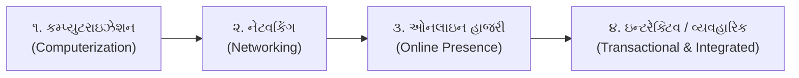
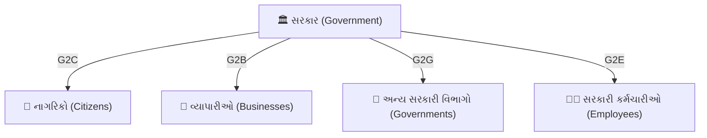
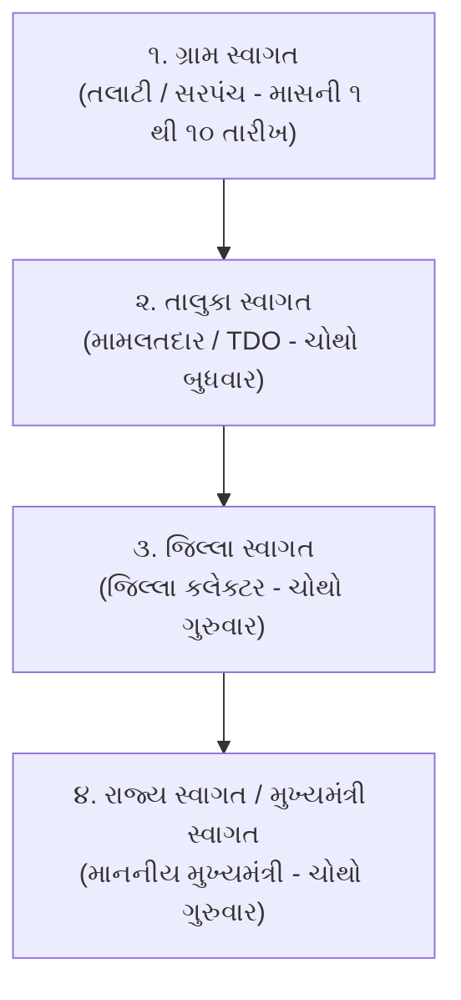
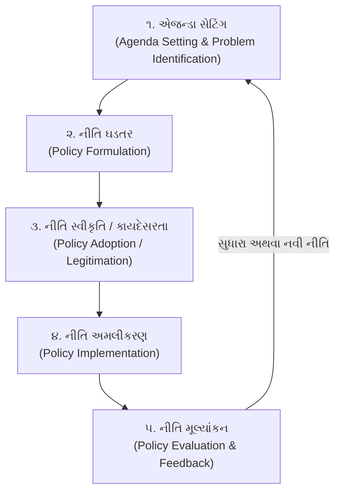

# જાહેર વહીવટ (Public Administration) | ભાગ - ૬
## ઈ-ગવર્નન્સ (E-Governance), ગુજરાતના ફ્લેગશિપ ડિજિટલ પ્રોજેક્ટ્સ (SWAGAT, ATVT, e-Dhara, i-Khedut) અને જાહેર નીતિ (Public Policy Life Cycle)

> **સંદર્ભ વ્યાખ્યાન:** LearningPocket GPSC - હેમંત શાહ સર (*Part-6: Public Administration | PSI | GPSC | Jaher Vahivat in Gujarati*)  
> **વિડિયો લિંક:** [https://www.youtube.com/live/DdQzWU5vDUU](https://www.youtube.com/live/DdQzWU5vDUU)  
> **સિલેબસ મેપિંગ:** GSSSB CCE Mains Group A (Paper-3: જાહેર વહીવટ અને શાસન - `sec3_top2`, `sec3_top3`, `sec3_top5`), GPSC Class 1/2 Mains, PSI Mains.

---

## અનુક્રમણિકા
1. [ઈ-ગવર્નન્સ: અર્થ, સંકલ્પના અને સ્માર્ટ ગવર્નન્સ સાથે સંબંધ](#૧-ઈ-ગવર્નન્સ-અર્થ-સંકલ્પના-અને-સ્માર્ટ-ગવર્નન્સ)
2. [ઈ-ગવર્નન્સના વિકાસના તબક્કા (Stages of E-Governance)](#૨-ઈ-ગવર્નન્સના-વિકાસના-તબક્કા)
3. [ઈ-ગવર્નન્સના ૪ મુખ્ય મોડલ્સ (4 Interaction Models)](#૩-ઈ-ગવર્નન્સના-૪-મુખ્ય-મોડલ્સ)
4. [રાષ્ટ્રીય કક્ષાની મુખ્ય પહેલો: NeGP અને Digital India ના સ્તંભો](#૪-રાષ્ટ્રીય-કક્ષાની-મુખ્ય-પહેલો-negp-અને-digital-india)
5. [ગુજરાત રાજ્યના અગ્રણી ઈ-ગવર્નન્સ પ્રોજેક્ટ્સ](#૫-ગુજરાત-રાજ્યના-અગ્રણી-ઈ-ગવર્નન્સ-પ્રોજેક્ટ્સ)
   - [GSWAN અને ગુજરાત સ્ટેટ ડેટા સેન્ટર (GSDC)](#gswan-અને-ગુજરાત-સ્ટેટ-ડેટા-સેન્ટર-gsdc)
   - [SWAGAT ઓનલાઇન પોર્ટલ (UN Public Service Award 2010)](#swagat-ઓનલાઇન-પોર્ટલ)
   - [ATVT (આપણો તાલુકો વાઇબ્રન્ટ તાલુકો) અને જનસેવા કેન્દ્રો](#atvt-આપણો-તાલુકો-વાઇબ્રન્ટ-તાલુકો)
   - [e-Dhara (ઈ-ધરા / ભૂલેખ - RoR 7/12 & 8A)](#e-dhara-ઈ-ધરા--ભૂલેખ)
   - [i-Khedut પોર્ટલ (સિંગલ વિન્ડો ખેડૂત કલ્યાણ)](#i-khedut-પોર્ટલ)
   - [e-Nagar પોર્ટલ (શહેરી સ્થાનિક સ્વરાજ્ય સેવાઓ)](#e-nagar-પોર્ટલ)
   - [e-GujCop (ગુજરાત પોલીસ ક્રાઇમ ટ્રેકિંગ)](#e-gujcop-પ્રોજેક્ટ)
   - [CM Dashboard (વાસ્તવિક સમયનું સર્વોચ્ચ મોનિટરિંગ)](#cm-dashboard)
6. [જાહેર નીતિ (Public Policy): સંકલ્પના, મહત્વ અને લક્ષણો](#૬-જાહેર-નીતિ-public-policy-સંકલ્પના-અને-લક્ષણો)
7. [નીતિ નિર્માણનું ચક્ર (Policy Making Life Cycle)](#૭-નીતિ-નિર્માણનું-ચક્ર-policy-making-life-cycle)
8. [જાહેર નીતિ વિશ્લેષણના પ્રમુખ મોડેલ્સ (Policy Analysis Models)](#૮-જાહેર-નીતિ-વિશ્લેષણના-પ્રમુખ-મોડેલ્સ)
9. [નીતિ અમલીકરણના અભિગમો અને વહીવટી પડકારો](#૯-નીતિ-અમલીકરણના-અભિગમો-અને-પડકારો)
10. [નાગરિક સહભાગિતા અને સોશિયલ ઓડિટ (Social Audit)](#૧૦-નાગરિક-સહભાગિતા-અને-સોશિયલ-ઓડિટ)
11. [CCE Mains મોડેલ પ્રશ્નોત્તરો (૨ અને ૫ ગુણ)](#૧૧-cce-mains-મોડેલ-પ્રશ્નોત્તરો)
12. [૧૦ હાઈ-યીલ્ડ MCQs (વિસ્તૃત સમજૂતી સાથે)](#૧૨-૧૦-હાઈ-યીલ્ડ-mcqs)

---

## ૧. ઈ-ગવર્નન્સ: અર્થ, સંકલ્પના અને સ્માર્ટ ગવર્નન્સ

### 💡 ઈ-ગવર્નન્સ (Electronic Governance) એટલે શું?
* **વ્યાખ્યા:** સરકારી વહીવટમાં માહિતી અને સંચાર તકનીક (Information and Communication Technology - ICT) નો અસરકારક ઉપયોગ કરીને નાગરિકો, વ્યવસાયો અને કર્મચારીઓને ઝડપી, પારદર્શક, સસ્તી અને ભ્રષ્ટાચારમુક્ત સેવાઓ પૂરી પાડવાની વ્યવસ્થા.
* વિશ્વ બેંક (World Bank) ના મતે: *"E-Governance refers to the use by government agencies of information technologies that have the ability to transform relations with citizens, businesses, and other arms of government."*
* **ઈ-ગવર્નમેન્ટ વિ. ઈ-ગવર્નન્સ વચ્ચેનો ભેદ:**
  * **E-Government:** માત્ર વહીવટી તંત્રમાં કમ્પ્યુટર અને હાર્ડવેર/સોફ્ટવેરનું સંસ્થાપન (સાધન).
  * **E-Governance:** ICT ની મદદથી શાસન પ્રક્રિયા, નિર્ણય લેવાની પદ્ધતિ, નાગરિક સહભાગિતા અને જવાબદેહીનું સંપૂર્ણ પરિવર્તન (લક્ષ્ય).

### 🎯 SMART Governance સાથે જોડાણ
ઈ-ગવર્નન્સ એ સુશાસનના **SMART** સિદ્ધાંતને સાકાર કરવાનું પ્રમુખ ઉપકરણ છે:
* **S (Simple):** જટિલ સરકારી કાગળિયા નિયમોનું સરળીકરણ.
* **M (Moral):** નૈતિક મૂલ્યો અને વહીવટી નિષ્ઠાની સ્થાપના.
* **A (Accountable):** ફાઇલોની ઓનલાઇન મુવમેન્ટથી જવાબદેહીની સ્પષ્ટતા.
* **R (Responsive):** નાગરિકોની ફરિયાદો અને જરૂરિયાતો પ્રત્યે ત્વરિત પ્રતિક્રિયા.
* **T (Transparent):** જાહેર માહિતી ઓનલાઇન ઉપલબ્ધ કરાવી લાલફીતાશાહી અને ગુપ્તતાનો અંત.

---

## ૨. ઈ-ગવર્નન્સના વિકાસના તબક્કા (Stages of E-Governance)

સંયુક્ત રાષ્ટ્ર (UN) અને Gartner Research મુજબ ઈ-ગવર્નન્સનું સ્તર ૪ તબક્કામાં વિકસે છે:

1. **પ્રથમ તબક્કો - કમ્પ્યુટરાઇઝેશન (Computerization):**
   * સરકારી કચેરીઓમાં ટાઇપરાઇટરના સ્થાને કમ્પ્યુટરનો ઉપયોગ. ડેટા એન્ટ્રી અને સ્થાનિક રેકોર્ડનું ડિજિટાઈઝેશન.
2. **બીજો તબક્કો - નેટવર્કિંગ (Networking):**
   * વિવિધ સરકારી વિભાગોને લેન (LAN) અને વાન (WAN) દ્વારા જોડવા (દા.ત. NICNET, GSWAN).
3. **ત્રીજો તબક્કો - ઓનલાઇન હાજરી (Online Presence / Web Portals):**
   * સરકારી વિભાગોની વેબસાઇટ બનાવવી, નિયમો, ફોર્મ્સ અને GR ડાઉનલોડ કરવાની સગવડ (એકતરફી માહિતી સંચાર).
4. **ચોથો તબક્કો - વ્યવહારિક અને સંકલિત શાસન (Transactional & Integrated Phase):**
   * ઓનલાઇન પેમેન્ટ, ડિજિટલ સહીવાળા દાખલા, દ્વિમાર્ગીય સંચાર અને સિંગલ-વિન્ડો ક્લિયરન્સ (દા.ત. Digital Gujarat, DigiLocker, UPI).

---

## ૩. ઈ-ગવર્નન્સના ૪ મુખ્ય મોડલ્સ (4 Interaction Models)

સરકાર અને વિવિધ હિતધારકો વચ્ચેના સંબંધના આધારે ઈ-ગવર્નન્સને ૪ મોડલ્સમાં વર્ગીકૃત કરાય છે:

| મોડેલ | સંપૂર્ણ નામ | અર્થ અને ઉદ્દેશ | મુખ્ય ઉદાહરણો |
| :--- | :--- | :--- | :--- |
| **G2C** | **Government to Citizen** | સરકારથી નાગરિક તરફની સેવાઓ. નાગરિકોને ઘરે બેઠા દાખલા, લાયસન્સ અને કલ્યાણકારી યોજનાઓ પહોંચાડવી. | Digital Gujarat, e-Nagar, SWAGAT, ભૂલેખ/e-Dhara, DigiLocker, Parivahan (DL/RC). |
| **G2B** | **Government to Business** | સરકાર અને વ્યાપારી સંસ્થાઓ વચ્ચેનો સંચાર. ઇઝ ઓફ ડૂઇંગ બિઝનેસ, ટેક્સ સબમિશન અને લાયસન્સિંગ. | GST પોર્લ, GeM (Government e-Marketplace), MCA21, ઇન્કમ ટેક્સ ફાઇલિંગ પોર્ટલ. |
| **G2G** | **Government to Government** | કેન્દ્ર-રાજ્ય, આંતર-વિભાગીય અથવા રાજ્ય-સ્થાનિક સ્વરાજ્ય વચ્ચે સંકલન અને ડેટા શેરિંગ. | e-Office, GSWAN, SmartGov, કાગળ રહિત કેબિનેટ (Paperless Cabinet), CCTNS. |
| **G2E** | **Government to Employee** | સરકાર અને તેના સનદી સેવકો/કર્મચારીઓ વચ્ચેનો વહીવટ. પગાર, રજા, પેન્શન અને સર્વિસ બુક મેનેજમેન્ટ. | IFMS (Integrated Financial Management System), e-HRMS, SPARROW (IAS/IPS ના APAR રેટિંગ). |

---

## ૪. રાષ્ટ્રીય કક્ષાની મુખ્ય પહેલો: NeGP અને Digital India

### 🇮🇳 ૧. નેશનલ ઈ-ગવર્નન્સ પ્લાન (NeGP - 2006)
* ભારત સરકાર દ્વારા **૧૮ મે ૨૦૦૬** ના રોજ મંજૂર કરાયો.
* **ધ્યેય સૂત્ર (Vision):** *"સામાન્ય નાગરિકને તેના જ વિસ્તારમાં સિંગલ-વિન્ડો દ્વારા સસ્તી, વિશ્વસનીય અને પારદર્શક સરકારી સેવાઓ પૂરી પાડવી."*
* **માળખું:** ૩૧ મિશન મોડ પ્રોજેક્ટ્સ (MMPs) - કેન્દ્રીય સ્તરના (પાસપોર્ટ, MCA21, આવકવેરો), રાજ્ય સ્તરના (જમીન રેકોર્ડ્સ, વાહન પરિવહન, પોલીસ), અને સંયુક્ત પ્રોજેક્ટ્સ (CSC, e-Biz).
* **ત્રણ પાયાના સ્તંભો (3 Core Infrastructure Components):**
  1. **SWAN (State Wide Area Network):** તમામ રાજ્યોમાં તાલુકા સ્તર સુધી સુરક્ષિત હાઇ-સ્પીડ નેટવર્ક.
  2. **SDC (State Data Centre):** રાજ્યના તમામ વિભાગોના સર્વર અને ડેટાનું સુરક્ષિત કેન્દ્રીકરણ.
  3. **CSC (Common Service Centres):** ગ્રામીણ નાગરિકો માટે ફિઝિકલ ડિજિટલ સેવા કેન્દ્રો.

### 🌐 ૨. ડિજિટલ ઇન્ડિયા કાર્યક્રમ (Digital India - ૧ જુલાઈ ૨૦૧૫)
* **પ્રધાનમંત્રી નરેન્દ્ર મોદી** દ્વારા શરૂ કરાયો.
* **ડિજિટલ ઇન્ડિયાના ૯ સ્તંભો (9 Pillars):**
  1. બ્રોડબેન્ડ હાઇવે (Broadband Highways - BharatNet)
  2. સાર્વત્રિક મોબાઇલ કનેક્ટિવિટી (Universal Access to Mobile)
  3. પબ્લિક ઇન્ટરનેટ એક્સેસ પ્રોગ્રામ (CSC નું વિસ્તરણ)
  4. ઈ-ગવર્નન્સ: તકનીક દ્વારા સરકારી સુધારણા (IT-driven Governance)
  5. ઈ-ક્રાંતિ: ઇલેક્ટ્રોનિક સેવા વિતરણ (Electronic Delivery of Services)
  6. સૌ માટે માહિતી (Information for All - Open Data Portal)
  7. ઇલેક્ટ્રોનિક્સ મેન્યુફેક્ચરિંગ (Electronics Manufacturing)
  8. રોજગાર માટે આઈટી (IT for Jobs)
  9. અર્લી હાર્વેસ્ટ પ્રોગ્રામ્સ (Early Harvest Programmes)

---

## ૫. ગુજરાત રાજ્યના અગ્રણી ઈ-ગવર્નન્સ પ્રોજેક્ટ્સ

ગુજરાત ભારતમાં ઈ-ગવર્નન્સ ક્ષેત્રે પાયોનિયર (અગ્રદૂત) રાજ્ય રહ્યું છે. CCE Mains અને GPSC ની પરીક્ષા માટે ગુજરાતના નીચેના ૮ પ્રોજેક્ટ્સ અતિ મહત્વપૂર્ણ છે:

### 🌐 ૧. GSWAN (Gujarat State Wide Area Network)
* **વિશેષતા:** એશિયાનું સૌથી મોટું અને સૌથી વ્યાપક સ્ટેટ વાઇડ એરિયા નેટવર્ક.
* સચિવાલય (ગાંધીનગર) થી શરૂ કરી તમામ જિલ્લા કલેક્ટર કચેરીઓ, જિલ્લા પંચાયતો, તાલુકા મામલતદાર કચેરીઓ અને TDO કચેરીઓને IP-બેઝ્ડ ફાઈબર નેટવર્ક દ્વારા જોડે છે.
* વોઇસ, ડેટા અને વીડિયો કોન્ફરન્સિંગ એક જ નેટવર્ક પર સંભવ બનાવ્યું.
* **GSDC (Gujarat State Data Centre):** ગાંધીનગરમાં સ્થાપિત ISO પ્રમાણિત સુરક્ષિત ડેટા સેન્ટર જે તમામ સરકારી પોર્ટલોનું કેન્દ્રીય હોસ્ટિંગ કરે છે.

---

### 🌟 ૨. SWAGAT ઓનલાઇન પોર્ટલ (State Wide Attention on Grievances by Application of Technology)
* **શરૂઆત:** એપ્રિલ ૨૦૦૩ (તત્કાલીન મુખ્યમંત્રી નરેન્દ્ર મોદી દ્વારા).
* **ઉદ્દેશ:** નાગરિકોની લાંબા સમયથી વણઉકેલાયેલી ફરિયાદોનું ટેકનોલોજી અને વીડિયો કોન્ફરન્સિંગ દ્વારા સીધું નિવારણ.
* **૪-સ્તરીય લોકફરિયાદ નિવારણ મોડેલ:**
  1. **મુખ્યમંત્રી સ્વાગત (State Level):** દર મહિનાના ચોથા ગુરુવારે સચિવાલય ખાતે મુખ્યમંત્રી સમક્ષ સીધી સુનાવણી.
  2. **જિલ્લા સ્વાગત (District Level):** દર મહિનાના ચોથા ગુરુવારે કલેક્ટર કચેરી ખાતે.
  3. **તાલુકા સ્વાગત (Taluka Level):** દર મહિનાના ચોથા બુધવારે મામલતદાર/TDO કચેરી ખાતે.
  4. **ગ્રામ સ્વાગત (Village Level):** દર મહિનાના ૧ થી ૧૦ તારીખ દરમિયાન તલાટી/સરપંચ દ્વારા અરજી સ્વીકાર.
* **વૈશ્વિક માન્યતા:** વર્ષ ૨૦૧૦ માં સંયુક્ત રાષ્ટ્ર (United Nations) દ્વારા લોકસેવા ક્ષેત્રે પ્રતિષ્ઠિત **"UN Public Service Award"** થી સન્માનિત.

---

### 🏢 ૩. ATVT (આપણો તાલુકો વાઇબ્રન્ટ તાલુકો) અને જનસેવા કેન્દ્રો
* **સંકલ્પના:** તાલુકાને વહીવટી સત્તા અને વિકાસનું કેન્દ્રબિંદુ બનાવવું.
* **જનસેવા કેન્દ્રો (Jan Seva Kendras):** તાલુકા મામલતદાર કચેરી ખાતે સિંગલ-વિન્ડો કાઉન્ટર.
* જાતિના દાખલા, આવકના દાખલા, નોન-ક્રીમીલેયર, રેશનકાર્ડ, બોનાફાઇડ, સીનિયર સિટીઝન કાર્ડ જેવા ૩૫ થી વધુ દાખલાઓ બારકોડ અને ડિજિટલ સહી સાથે નક્કી કરેલ સમયમર્યાદામાં પૂરા પાડવા.
* નાગરિકોને વચેટિયાઓ કે દલાલોના શોષણમાંથી મુક્તિ આપવી.

---

### 🌾 ૪. e-Dhara (ઈ-ધરા / ભૂલેખ પ્રોજેક્ટ)
* **ક્ષેત્ર:** મહેસૂલ વહીવટ અને જમીન સુધારણા.
* ગુજરાતના તમામ ગામોના જમીન રેકોર્ડ્સ (RoR - Record of Rights):
  * **૭/૧૨ નો ઉતારો** (જમીન માલિકી અને પાકની વિગત)
  * **૮-અ નો ખાતાવહી ઉતારો**
  * **હક્કપત્રક નોંધ (ગામ નમૂનો નં. ૬ - Mutation Entry)**
* હસ્તલિખિત પદ્ધતિ બંધ કરી ૧૦૦% કમ્પ્યુટરાઇઝ્ડ અને ઓનલાઇન ઉપલબ્ધ કરાયા.
* **લાભ:** જમીન છેતરપિંડીમાં ઘટાડો, ખેડૂતને બેંક લોન લેવામાં સરળતા, અને પારદર્શક મ્યુટેશન (નોંધ પ્રમાણીકરણ) પ્રક્રિયા.

---

### 🚜 ૫. i-Khedut પોર્ટલ
* **સંકલ્પના:** ગુજરાત સરકારના કૃષિ, પશુપાલન, બાગાયત અને મત્સ્યોદ્યોગ વિભાગનું સિંગલ-વિન્ડો વેબ પોર્ટલ.
* ખેડૂતો માટે સબસિડી (ટ્રેક્ટર સહાય, ડ્રિપ ઇરિગેશન, સોલાર પંપ, પાક સંરક્ષણ કીટ, તાડપત્રી સહાય) ની ઓનલાઇન અરજી.
* અરજીની સ્થિતિ (Application Status) ની પારદર્શક ટ્રેકિંગ અને ડીબીટી (Direct Benefit Transfer - DBT) દ્વારા સીધા બેંક ખાતામાં નાણાં જમા.

---

### 🏙️ ૬. e-Nagar પોર્ટલ
* **ક્ષેત્ર:** શહેરી વિકાસ અને શહેરી સ્થાનિક સ્વરાજ્ય સંસ્થાઓ (ULBs).
* ગુજરાતની તમામ ૮ મહાનગરપાલિકાઓ (Municipal Corporations) અને ૧૫૭+ નગરપાલિકાઓ (Municipalities) ને એક જ કોમન ડિજિટલ પ્લેટફોર્મ પર આવરી લેવાઈ.
* **૫૨+ નાગરિક સેવાઓ ઉપલબ્ધ:**
  * મિલકત વેરો (Property Tax) અને વ્યવસાય વેરો (Professional Tax) ભરવો
  * જન્મ અને મરણના દાખલા ડાઉનલોડ કરવા
  * પાણી અને ગટર કનેક્શન અરજી
  * બાંધકામ પરવાનગી (Building Permission) અને ફાયર એન.ઓ.સી. (Fire NOC)
  * દુકાન અને સંસ્થા નોંધણી (Shop Establishment Registration)

---

### 👮 ૭. e-GujCop પ્રોજેક્ટ
* **સંકલ્પના:** ગૃહ વિભાગ અને ગુજરાત પોલીસનું સંપૂર્ણ ડિજિટાઇઝેશન.
* રાજ્યના ૧૦૦% પોલીસ સ્ટેશનો, જેલો, ફોરેન્સિક સાયન્સ લેબોરેટરી (FSL) અને CID ને જોડતું એકીકૃત નેટવર્ક.
* **કાર્યો:** ઓનલાઇન e-FIR, ગુનેગારોનો ડેટાબેઝ, વોન્ટેડ આરોપીઓની ઓળખ, સીસીટીવી સર્વેલન્સ (VISWAS પ્રોજેક્ટ સાથે જોડાણ) અને સિટીઝન ફર્સ્ટ (Citizen First) મોબાઇલ એપ્લિકેશન દ્વારા પોલીસ વેરિફિકેશન સેવાઓ.

---

### 📊 ૮. CM Dashboard (મુખ્યમંત્રી ડેશબોર્ડ)
* **ગાંધીનગર સચિવાલય** ખાતે સ્થાપિત અત્યાધુનિક ડિજિટલ કમાન્ડ એન્ડ કંટ્રોલ સેન્ટર.
* રાજ્ય સરકારના ૨૦+ થી વધુ વિભાગોના ૩,૦૦૦+ થી વધુ કી પરફોર્મન્સ ઇન્ડિકેટર્સ (KPIs) નું વાસ્તવિક સમય (Real-Time) મોનિટરિંગ.
* મુખ્યમંત્રી પોતે સીધા જ કોઈપણ જિલ્લા, તાલુકા કે યોજના (દા.ત. નલ સે જલ, આવાસ યોજના, અનાજ વિતરણ) ની પ્રગતિનું લાઇવ મૂલ્યાંકન કરી શકે છે.

---

## ૬. જાહેર નીતિ (Public Policy): સંકલ્પના અને લક્ષણો

### 📖 જાહેર નીતિ એટલે શું?
* **થોમસ ડાઇ (Thomas Dye) ની વ્યાખ્યા:** *"જાહેર નીતિ એટલે સરકારે શું કરવું કે શું ન કરવું તેની પસંદગી (Public policy is whatever governments choose to do or not to do)."*
* તે માત્ર કાયદો કે વટહુકમ નથી, પરંતુ ચોક્કસ સામાજિક, આર્થિક કે રાજકીય સમસ્યાઓના ઉકેલ માટે સરકાર દ્વારા લેવાતા આયોજનબદ્ધ નિર્ણયો અને માર્ગદર્શિકાઓનો સંગ્રહ છે.

### 🌟 જાહેર નીતિના મુખ્ય લક્ષણો
1. **ધ્યેયલક્ષી (Goal-Oriented):** ચોક્કસ જાહેર હિત અને બંધારણીય આદર્શો (રાજ્યનીતિના માર્ગદર્શક સિદ્ધાંતો) સિદ્ધ કરવા ઘડાય છે.
2. **કાયદેસરતા (Legitimacy):** તે સાર્વભૌમ રાજ્યસત્તા (સરકાર) દ્વારા ઘડવામાં આવતી હોવાથી કાનૂની પીઠબળ ધરાવે છે.
3. **ગતિશીલ પ્રક્રિયા (Dynamic Process):** સામાજિક-આર્થિક સંજોગો બદલાતા નીતિમાં સમયાંતરે સુધારા કરવા પડે છે.
4. **સકારાત્મક અને નકારાત્મક પાસું:** સરકાર કોઈ પગલું ભરે (દા.ત. નવી શિક્ષણ નીતિ) તે સકારાત્મક નીતિ છે; સરકાર કોઈ બાબતમાં દખલ ન કરવાનો નિર્ણય લે તે નકારાત્મક/તટસ્થ નીતિ છે.

---

## ૭. નીતિ નિર્માણનું ચક્ર (Policy Making Life Cycle)

જાહેર નીતિ એક રેખીય ઘટના નથી, પરંતુ ૫ તબક્કાનું અવિરત ચક્ર છે:

| તબક્કો | નામ | પ્રક્રિયા અને મુખ્ય ભૂમિકા |
| :--- | :--- | :--- |
| **૧** | **એજન્ડા સેટિંગ (Agenda Setting)** | સમાજની કઈ સમસ્યા તાકીદની છે તે નક્કી કરવું. મીડિયા, નાગરિક આંદોલનો, ન્યાયતંત્ર અને રાજકીય પક્ષો દબાણ જૂથ તરીકે કામ કરે છે. |
| **૨** | **નીતિ ઘડતર (Policy Formulation)** | સમસ્યાના ઉકેલ માટે વિવિધ વિકલ્પો તૈયાર કરવા. સચિવાલયના સનદી સેવકો, નીતિ આયોગ, કેબિનેટ કમિટીઓ અને વિષય તજજ્ઞો ડ્રાફ્ટ બનાવે છે. |
| **૩** | **નીતિ સ્વીકૃતિ (Policy Adoption)** | સંસદ/વિધાનસભા દ્વારા કાયદો પસાર કરવો અથવા કેબિનેટ દ્વારા સત્તાવાર મંજૂરી આપવી (કાયદેસરતા બક્ષવી). |
| **૪** | **નીતિ અમલીકરણ (Policy Implementation)** | ફિલ્ડ વહીવટકર્તાઓ (કલેક્ટર, DDO, મ્યુનિસિપલ કમિશનર, પોલીસ) દ્વારા યોજનાનો જમીની સ્તરે અમલ. |
| **૫** | **નીતિ મૂલ્યાંકન (Policy Evaluation)** | નીતિ સફળ રહી કે નિષ્ફળ તેનું ઓડિટ. CAG, સોશિયલ ઓડિટ, નીતિ આયોગ અને સંસદીય સમિતિઓ દ્વારા મૂલ્યાંકન અને પુનરાવર્તન (Feedback). |

---

## ૮. જાહેર નીતિ વિશ્લેષણના પ્રમુખ મોડેલ્સ

જાહેર વહીવટના વિચારકોએ નીતિ ઘડતરને સમજવા માટે વિવિધ સિદ્ધાંતો આપ્યા છે:

1. **સંસ્થાકીય મોડેલ (Institutional Model):**
   * નીતિ એ સરકારી સંસ્થાઓ (સંસદ, કારોબારી, ન્યાયતંત્ર) નું ઉત્પાદન છે. સરકારી સંસ્થા જ નીતિને કાયદેસરતા અને સાર્વત્રિકતા આપે છે.
2. **રેશનલ મોડેલ (Rational Model - Herbert Simon):**
   * નીતિ ઘડવૈયાઓ તમામ સંભવિત વિકલ્પો અને તેના ખર્ચ-લાભ (Cost-Benefit Analysis) નું તાર્કિક ગણિત માંડીને મહત્તમ સામાજિક લાભ આપતો શ્રેષ્ઠ વિકલ્પ પસંદ કરે છે. (જોકે સાયમનના મતે મનુષ્યની મર્યાદિત તાર્કિકતા - Bounded Rationality ના કારણે આ આદર્શવાદી છે).
3. **ઇન્ક્રીમેન્ટલ મોડેલ (Incremental Model - Charles Lindblom):**
   * લિન્ડબ્લોમની પ્રસિદ્ધ વિભાવના: *"The Science of 'Muddling Through'"* (૧૯૫૯).
   * સરકાર ક્યારેય સંપૂર્ણ નવી નીતિ બનાવતી નથી, પરંતુ અગાઉથી ચાલતી નીતિઓમાં **નાના-નાના ક્રમશઃ ફેરફારો (Incremental Changes)** કરે છે, કારણ કે આમ કરવાથી રાજકીય વિરોધ ઓછો થાય છે.
4. **મિશ્ર મોડેલ (Mixed Scanning Model - Amitai Etzioni):**
   * રેશનલ મોડેલ (બૃહદ દ્રષ્ટિ) અને ઇન્ક્રીમેન્ટલ મોડેલ (ઝીણવટભરી વિગત) નો સુમેળ.

---

## ૯. નીતિ અમલીકરણના અભિગમો અને પડકારો

### ⚖️ ટોપ-ડાઉન (Top-Down) વિ. બોટમ-અપ (Bottom-Up) અભિગમ

| તુલનાત્મક પાસાં | ટોપ-ડાઉન અભિગમ (Top-Down Approach) | બોટમ-અપ અભિગમ (Bottom-Up Approach) |
| :--- | :--- | :--- |
| **નિર્ણયનું સ્તર** | કેન્દ્રીય સ્તરે ઉચ્ચ સત્તાધીશો (મંત્રીઓ/સચિવો) દ્વારા નીતિ નક્કી થાય છે. | સ્થાનિક પાયાના સ્તર (પંચાયત, ગ્રામસભા, ફિલ્ડ વર્કર્સ) ની જરૂરિયાતોથી શરૂ થાય છે. |
| **અધિકાર પ્રવાહ** | આદેશો ઉપરથી નીચે તરફ વહે છે (અધિકારશ્રેણી આધારિત). | સ્થાનિક હિતધારકોની સહભાગિતાથી ઉપર તરફ જાય છે. |
| **સ્થાનિક અનુકૂલન** | સ્થાનિક વિવિધતા અને સમસ્યાઓની ઉપેક્ષા થવાનું જોખમ. | સ્થાનિક ભૌગોલિક અને સામાજિક વાસ્તવિકતાઓને અનુકૂળ. |
| **ઉદાહરણ** | ભૂતપૂર્વ યોજના આયોગ (Planning Commission). | **નીતિ આયોગ (NITI Aayog)** અને વિકેન્દ્રિત જિલ્લા આયોજન. |

### ⚠️ નીતિ અમલીકરણમાં આવતા મુખ્ય વહીવટી પડકારો
1. **નીતિગત લકવો (Policy Paralysis):** રાજકીય અનિર્ણાયકતા અથવા ગઠબંધન સરકારના દબાણને કારણે સમયસર નિર્ણયો ન લેવાવા.
2. **અમલદારશાહી લાલફીતાશાહી (Bureaucratic Red-Tapism):** પ્રક્રિયા અને કાગળિયા નિયમો પર વધુ પડતો ભાર, પરિણામ (Outcome) ની ઉપેક્ષા.
3. **સંકલનનો અભાવ (Lack of Inter-Departmental Coordination):** વિવિધ મંત્રાલયો વચ્ચે સિલો મેન્ટાલિટી (Silo Mentality - એકબીજા સાથે ડેટા શેર ન કરવો).
4. **સંસાધન મર્યાદા (Resource Crunch):** નાણાં, તકનીક અને પ્રશિક્ષિત માનવબળની અછત.
5. **જનસહભાગિતાનો અભાવ:** સ્થાનિક નાગરિકોને નીતિ ઘડતરમાં સામેલ ન કરવાથી યોજનાનો અસ્વીકાર થવો.

---

## ૧૦. નાગરિક સહભાગિતા અને સોશિયલ ઓડિટ (Social Audit)

### 👥 સોશિયલ ઓડિટ (સામાજિક ઓડિટ) એટલે શું?
* **અર્થ:** સરકારી યોજનાઓ, વિકાસ કામો અને જાહેર ભંડોળનો ઉપયોગ નિયમાનુસાર અને લાભાર્થીઓના હિતમાં થયો છે કે નહીં તેની **સ્થાનિક લોકો/લાભાર્થીઓ દ્વારા જાતે કરવામાં આવતી તપાસ**.
* તે માત્ર નાણાકીય હિસાબ-કિતાબ (Financial Audit) નથી, પરંતુ સામાજિક પરિણામ (Social Impact) નું મૂલ્યાંકન છે.

### 📜 ઉદ્ભવ અને ઐતિહાસિક પૃષ્ઠભૂમિ
* ભારતમાં સોશિયલ ઓડિટની ચળવળનો પાયો રાજસ્થાનમાં **અરુણા રોય** અને **મઝદૂર કિસાન શક્તિ સંગઠન (MKSS)** દ્વારા ૧૯૯૦ ના દાયકામાં નખાયો.
* MKSS ના સૂત્ર: *"હમારા પૈસા, હમારા હિસાબ"* અને *"જાનને કા હક, જીને કા હક"*.
* **કાનૂની જોગવાઈ:** **MGNREGA Act 2005 ની કલમ ૧૭** હેઠળ તમામ મનરેગા કામોનું ગ્રામસભા દ્વારા સોશિયલ ઓડિટ કરવું કાયદેસર રીતે ફરજિયાત બનાવવામાં આવ્યું.
* સોશિયલ ઓડિટનું આયોજન કરનાર ભારતનું પ્રથમ રાજ્ય: **આંધ્રપ્રદેશ** (સ્વતંત્ર સોશિયલ ઓડિટ સોસાયટી બનાવી).

---

## ૧૧. CCE Mains મોડેલ પ્રશ્નોત્તરો

### 📝 પ્રશ્ન ૧ (૨ ગુણ): ઈ-ગવર્નન્સના સંદર્ભમાં G2C અને G2B મોડલ વચ્ચેનો તફાવત ઉદાહરણ આપી સ્પષ્ટ કરો.
**આદર્શ ઉત્તર:**
1. **G2C (Government to Citizen):** સરકાર દ્વારા સામાન્ય નાગરિકોને સીધી લોકસેવાઓ પૂરી પાડવાનું મોડેલ છે (દા.ત. *Digital Gujarat* પોર્ટલ પરથી જાતિ કે આવકનો દાખલો મેળવવો, *e-Dhara* પરથી ૭/૧૨ નો ઉતારો મેળવવો).
2. **G2B (Government to Business):** સરકાર અને ખાનગી વેપારી એકમો વચ્ચેનું ઇન્ટરફેસ છે, જે વ્યાપાર સુગમતા (Ease of Doing Business) વધારે છે (દા.ત. *GST પોર્ટલ* પર વેપારીઓ દ્વારા રિટર્ન ભરવું, *GeM પોર્ટલ* પરથી સરકારી ખરીદી).

---

### 📝 પ્રશ્ન ૨ (૨ ગુણ): જાહેર નીતિ નિર્માણમાં ચાર્લ્સ લિન્ડબ્લોમનો 'ઇન્ક્રીમેન્ટલ મોડેલ' (Incremental Model) શું સમજાવે છે?
**આદર્શ ઉત્તર:**
ચાર્લ્સ લિન્ડબ્લોમે ૧૯૫૯ માં *"The Science of 'Muddling Through'"* નિબંધમાં જણાવ્યું કે સરકારો શૂન્યમાંથી સંપૂર્ણ નવી કે ક્રાંતિકારી નીતિઓ બનાવતી નથી. તેના બદલે, વહીવટીતંત્ર અગાઉથી ચાલી રહેલી પ્રવર્તમાન નીતિઓમાં સામાજિક-રાજકીય વિરોધ ટાળવા માત્ર **નાના-નાના ક્રમિક વધારા (Incremental adjustments)** કરે છે.

---

### 📝 પ્રશ્ન ૩ (૫ ગુણ): ગુજરાત સરકારના 'SWAGAT' ઓનલાઇન પોર્ટલની સંકલ્પના સમજાવી, તેના ચાર સ્તરીય માળખા અને પ્રભાવનું મૂલ્યાંકન કરો.
**આદર્શ ઉત્તર:**
* **પ્રસ્તાવના:** 'SWAGAT' (State Wide Attention on Grievances by Application of Technology) એ વર્ષ ૨૦૦૩ થી કાર્યરત ગુજરાતનું ટેકનોલોજી આધારિત જનફરિયાદ નિવારણ મોડેલ છે, જેને ૨૦૧૦ માં સંયુક્ત રાષ્ટ્ર (UN) દ્વારા પ્રતિષ્ઠિત **UN Public Service Award** એનાયત થયો હતો.
* **૪-સ્તરીય વહીવટી માળખું:**
  1. **ગ્રામ સ્વાગત:** દર મહિનાની ૧ થી ૧૦ તારીખે તલાટી/સરપંચ દ્વારા ગ્રામીણ અરજીઓ સ્વીકારવામાં આવે છે.
  2. **તાલુકા સ્વાગત:** દર મહિનાના ચોથા બુધવારે મામલતદાર અને TDO કચેરી ખાતે તાલુકા કક્ષાએ સુનાવણી.
  3. **જિલ્લા સ્વાગત:** દર મહિનાના ચોથા ગુરુવારે જિલ્લા કલેક્ટરની અધ્યક્ષતામાં જિલ્લા સ્તરના પ્રશ્નોનું નિવારણ.
  4. **રાજ્ય / મુખ્યમંત્રી સ્વાગત:** દર મહિનાના ચોથા ગુરુવારે ગાંધીનગર ખાતે મુખ્યમંત્રી દ્વારા વીડિયો કોન્ફરન્સિંગથી નાગરિકો સાથે સીધો સંવાદ અને વણઉકેલાયેલા જટિલ પ્રશ્નોનો ઓન-ધ-સ્પોટ નિકાલ.
* **પ્રભાવ અને મહત્વ:**
  * વચેટિયાઓનો અંત અને છેવાડાના માનવી સુધી શાસનની સીધી પહોંચ.
  * વાસ્તવિક સમયમાં વહીવટી જવાબદેહી (Accountability) નું નિર્માણ.
  * વહીવટી તંત્રમાં પ્રશ્નોને ટાળવાની (Red-tapism) વૃત્તિ પર અંકુશ.

---

### 📝 પ્રશ્ન ૪ (૫ ગુણ): "જાહેર નીતિના અમલીકરણમાં ટોપ-ડાઉન અભિગમ કરતાં બોટમ-અપ અભિગમ વધુ લોકશાહી અને અસરકારક છે." - ચર્ચા કરો.
**આદર્શ ઉત્તર:**
* **પ્રસ્તાવના:** જાહેર નીતિના અમલ માટે બે મુખ્ય અભિગમો પ્રચલિત છે: કેન્દ્રીય આદેશ આધારિત ટોપ-ડાઉન અને સ્થાનિક સહભાગિતા આધારિત બોટમ-અપ.
* **ટોપ-ડાઉન અભિગમની મર્યાદાઓ:**
  * ઉચ્ચ સ્તરે સચિવાલયમાં ઘડાયેલી નીતિઓ ઘણીવાર સ્થાનિક ભૌગોલિક અને સામાજિક વાસ્તવિકતાઓથી અલિપ્ત હોય છે (One Size Fits All).
  * નીચલા સ્તરના ફિલ્ડ સ્ટાફ માત્ર યંત્રવત આદેશોનું પાલન કરે છે, જેથી સ્થાનિક સમસ્યાઓનું સર્જનાત્મક નિરાકરણ આવતું નથી.
* **બોટમ-અપ અભિગમની શ્રેષ્ઠતા:**
  1. **વાસ્તવિક જરૂરિયાતોનું પ્રતિબિંબ:** ગ્રામસભા, પંચાયતો અને સ્થાનિક સમુદાયો પોતાની પ્રાથમિકતાઓ નક્કી કરે છે.
  2. **લોકશાહી સશક્તિકરણ:** ૭૩મા અને ૭૪મા બંધારણીય સુધારાની ભાવના મુજબ સત્તાનું સાચું વિકેન્દ્રીકરણ થાય છે.
  3. **અસરકારક માલિકીભાવ (Sense of Ownership):** સ્થાનિક લોકો યોજનાના આયોજન અને અમલમાં જોડાય ત્યારે ભ્રષ્ટાચાર ઘટે છે અને જાળવણી સારી થાય છે.
* **નિષ્કર્ષ:** ભારતમાં આયોજન પંચના સ્થાને **નીતિ આયોગ (NITI Aayog)** ની સ્થાપના અને મનરેગામાં ગ્રામસભાનું સોશિયલ ઓડિટ એ બોટમ-અપ અભિગમના સફળ ઉદાહરણો છે.

---

## ૧૨. ૧૦ હાઈ-યીલ્ડ MCQs

### ૧. ગુજરાત સરકારના ટેકનોલોજી આધારિત જનફરિયાદ નિવારણ પોર્ટલ 'SWAGAT' ને કયા વર્ષમાં સંયુક્ત રાષ્ટ્ર (United Nations) દ્વારા 'UN Public Service Award' એનાયત કરવામાં આવ્યો હતો?
* (A) ૨૦૦૫
* (B) ૨૦૦૮
* (C) ૨૦૧૦
* (D) ૨૦૧૪  
**જવાબ: (C) ૨૦૧૦**  
*સમજૂતી:* ૨૦૦૩ માં શરૂ થયેલા SWAGAT કાર્યક્રમને નાગરિકોની ફરિયાદોના ઝડપી અને પારદર્શક નિવારણ માટે વર્ષ ૨૦૧૦ માં UN Public Service Award મળ્યો હતો.

---

### ૨. ઈ-ગવર્નન્સના સંદર્ભમાં 'Digital Gujarat' અને 'e-Nagar' પોર્ટલ મુખ્યત્વે કયા ઇન્ટરેક્શન મોડેલ હેઠળ આવે છે?
* (A) G2G (Government to Government)
* (B) G2C (Government to Citizen)
* (C) G2B (Government to Business)
* (D) G2E (Government to Employee)  
**જવાબ: (B) G2C (Government to Citizen)**  
*સમજૂતી:* Digital Gujarat અને e-Nagar નાગરિકોને સીધી ઓનલાઇન સેવાઓ (દાખલા, પ્રમાણપત્રો, ટેક્સ પેમેન્ટ) પૂરી પાડતા હોવાથી તે Government to Citizen (G2C) મોડેલ છે.

---

### ૩. ગુજરાતમાં એશિયાનું સૌથી મોટું અને વ્યાપક ઈન્ટરનેટ/ઈન્ટ્રાનેટ નેટવર્ક કયું છે જે સચિવાલયથી લઈ તમામ જિલ્લા અને તાલુકા કચેરીઓને જોડે છે?
* (A) NICNET
* (B) GSWAN (Gujarat State Wide Area Network)
* (C) BharatNet
* (D) RailTel  
**જવાબ: (B) GSWAN (Gujarat State Wide Area Network)**  
*સમજૂતી:* GSWAN ગુજરાત સરકારની ડિજિટલ કરોડરજ્જુ છે જે તમામ સરકારી કચેરીઓને વૉઇસ, ડેટા અને વીડિયો કનેક્ટિવિટી પૂરી પાડે છે.

---

### ૪. ગુજરાતમાં જમીન મહેસૂલ રેકોર્ડ્સ (RoR - Record of Rights) જેમ કે ૭/૧૨ અને ૮-અ ના ઉતારાઓનું કમ્પ્યુટરાઇઝેશન કયા પ્રોજેક્ટ હેઠળ કરવામાં આવ્યું છે?
* (A) e-GujCop
* (B) e-Dhara (ભૂલેખ)
* (C) i-Khedut
* (D) ATVT  
**જવાબ: (B) e-Dhara (ભૂલેખ)**  
*સમજૂતી:* e-Dhara પ્રોજેક્ટ દ્વારા ગુજરાતના તમામ ગામોના જમીન રેકોર્ડ્સ અને હક્કપત્રક નોંધોનું સંપૂર્ણ ડિજિટાઇઝેશન કરવામાં આવ્યું છે.

---

### ૫. "The Science of 'Muddling Through'" નિબંધમાં જાહેર નીતિ નિર્માણના 'ઇન્ક્રીમેન્ટલ મોડેલ' (Incremental Model) ના પ્રણેતા કોણ હતા?
* (A) હર્બર્ટ સાયમન (Herbert Simon)
* (B) ચાર્લ્સ લિન્ડબ્લોમ (Charles Lindblom)
* (C) થોમસ ડાઇ (Thomas Dye)
* (D) વુડ્રો વિલ્સન (Woodrow Wilson)  
**જવાબ: (B) ચાર્લ્સ લિન્ડબ્લોમ (Charles Lindblom)**  
*સમજૂતી:* ચાર્લ્સ લિન્ડબ્લોમે ૧૯૫૯ માં જણાવ્યું કે સરકારો મૂળભૂત ધરમૂળથી ફેરફાર કરવાને બદલે પ્રવર્તમાન નીતિમાં ક્રમશઃ વધારા (Incremental changes) કરે છે.

---

### ૬. જાહેર નીતિ નિર્માણ ચક્ર (Policy Making Life Cycle) નો પ્રથમ તાર્કિક તબક્કો કયો છે?
* (A) નીતિ અમલીકરણ (Policy Implementation)
* (B) એજન્ડા સેટિંગ અને સમસ્યા ઓળખ (Agenda Setting)
* (C) નીતિ મૂલ્યાંકન (Policy Evaluation)
* (D) નીતિ કાયદેસરતા (Policy Legitimation)  
**જવાબ: (B) એજન્ડા સેટિંગ અને સમસ્યા ઓળખ (Agenda Setting)**  
*સમજૂતી:* નીતિ ચક્ર હંમેશા સમસ્યાની ઓળખ અને કઈ સમસ્યાને પ્રાથમિકતા આપવી તે 'એજન્ડા સેટિંગ' થી શરૂ થાય છે.

---

### ૭. જાહેર વહીવટમાં 'સોશિયલ ઓડિટ' (Social Audit) ની કાનૂની જોગવાઈ સૌપ્રથમ કયા કેન્દ્રીય અધિનિયમની કલમ ૧૭ હેઠળ ફરજિયાત બનાવવામાં આવી હતી?
* (A) RTI Act 2005
* (B) MGNREGA Act 2005
* (C) Lokpal Act 2013
* (D) Panchayats Extension to Scheduled Areas Act 1996  
**જવાબ: (B) MGNREGA Act 2005**  
*સમજૂતી:* મનરેગા કાયદાની કલમ ૧૭ હેઠળ તમામ મનરેગા કાર્યોનું ગ્રામસભા દ્વારા સોશિયલ ઓડિટ કરવું વૈધાનિક રીતે ફરજિયાત કરવામાં આવ્યું છે.

---

### ૮. સરકારી ખરીદીમાં પારદર્શિતા લાવવા અને ભ્રષ્ટાચાર નાબૂદ કરવા ભારત સરકાર દ્વારા શરૂ કરાયેલું 'GeM' પોર્ટલ કયા પ્રકારનું ઈ-ગવર્નન્સ મોડલ છે?
* (A) G2C
* (B) G2B (Government to Business)
* (C) G2E
* (D) C2C  
**જવાબ: (B) G2B (Government to Business)**  
*સમજૂતી:* GeM (Government e-Marketplace) એ સરકાર અને વ્યાપારીઓ/વેચાણકર્તાઓ વચ્ચેનું સત્તાવાર પ્લેટફોર્મ હોવાથી તે G2B મોડલ છે.

---

### ૯. ગુજરાત સરકારના 'ATVT' (આપણો તાલુકો વાઇબ્રન્ટ તાલુકો) કાર્યક્રમ હેઠળ નાગરિકોને ઝડપી દાખલા-પ્રમાણપત્રો આપવા કયા કેન્દ્રો કાર્યરત છે?
* (A) સુગમ કેન્દ્રો
* (B) જનસેવા કેન્દ્રો (Jan Seva Kendras)
* (C) ઉમંગ કેન્દ્રો
* (D) સાયબર સેન્ટર્સ  
**જવાબ: (B) જનસેવા કેન્દ્રો (Jan Seva Kendras)**  
*સમજૂતી:* તાલુકા મામલતદાર કચેરી ખાતે ATVT હેઠળ જનસેવા કેન્દ્રો શરૂ કરાયા છે જે સિંગલ-વિન્ડો દ્વારા ૩૫+ પ્રમાણપત્રો પૂરા પાડે છે.

---

### ૧૦. ગાંધીનગર સચિવાલય ખાતે સમગ્ર રાજ્યના ૨૦+ વિભાગોના ૩,૦૦૦+ કી પરફોર્મન્સ ઇન્ડિકેટર્સ (KPIs) નું વાસ્તવિક સમય (Real-Time) મોનિટરિંગ કઈ સિસ્ટમ દ્વારા થાય છે?
* (A) SWAGAT
* (B) CM Dashboard
* (C) e-Nagar
* (D) GSDC Portal  
**જવાબ: (B) CM Dashboard**  
*સમજૂતી:* CM Dashboard દ્વારા રાજ્ય સરકારના મુખ્ય પ્રોજેક્ટ્સ અને જનકલ્યાણ યોજનાઓનું સર્વોચ્ચ કક્ષાએથી રિયલ-ટાઇમ મોનિટરિંગ થાય છે.
